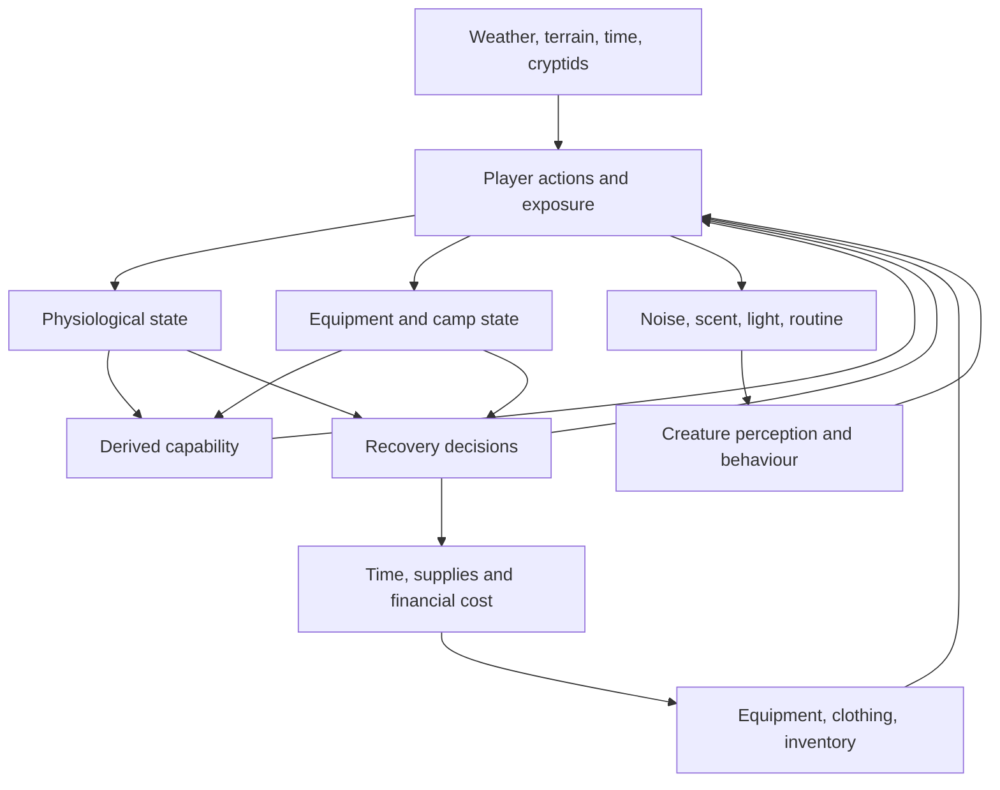

# Cryptozoology — Game Design Document

**Working title:** Cryptozoology  
**Version:** 1.1 — PC / WebXR presentation, gameplay gyms and profiling toolkit  
**Status:** Design baseline. Numerical values are initial tuning targets, not validated balance.

## 0. Game identity

**Genre:** First-person 3D hardcore survival horror meets search and capture. Premium single-player campaign for flatscreen PC and immersive VR (WebXR required), with thirteen repeatable expedition destinations and a persistent economic career. The player starts in Toronto with modest savings and ends in remote Canadian wilderness. The wilderness is the first antagonist; the cryptids eventually become the greater threat.

**Player fantasy:** Build a cryptozoology operation from ordinary camping gear and a cheap camera into a formidable research and specimen recovery enterprise. Survive, track, document, sell, reinvest and eventually capture. Every new destination costs money; every recovered trace can make a failed investigation worthwhile.

**Visual identity:** High-fidelity 3D environments rendered with deliberate pixel-art texture treatment and a coherent pixel scale. Naturalistic geometry, expressive silhouettes, richly authored materials, dramatic real-time lighting, deep shadows, atmospheric fog and readable localized light sources. The contrast between familiar ordinary places and rare disturbing creatures drives horror. First-person embodied equipment interactions; no third-person combat or character-stat RPG progression. Sound, shadow and partial visibility create tension before confrontation. See sections 12–13 for presentation and interaction rules.

**Platform identity:** One shared game simulation, progression, content and save schema, with desktop and immersive VR presentation/input adapters. VR is a first-class shipping mode, not a later port. The desktop game remains fully playable without a headset. Target a standalone Quest 3/3S-class browser as the initial VR reference; validate actual browser/device support. Native PC packaging and browser distribution do not change gameplay contracts.

**Core pillars:** Hardcore interconnected survival; evidence-driven search; independent creature behaviour; economic risk and reinvestment; escalating search-to-capture gameplay; horror grounded in uncertainty and readable systemic consequences.

**Document map:** 1 Survival; 2 Attributes; 3 Equipment; 4 Evidence; 5 Cryptid AI; 6 Expeditions/extraction; 7 Economy; 8 Capture/containment; 9 Failure/recovery; 10 Headquarters/career; 11 Narrative; 12 Level design; 13 UI/UX and presentation; 14 Independent systems; 15 Gameplay gyms; 16 PC/WebXR requirements; 17 profiling and JSON exports.

## 1. Survival systems

### 1.1 Design intent

A hardcore, expedition-based survival game in which an amateur cryptozoologist begins in Toronto and finances increasingly remote and dangerous investigations by selling evidence. Survival is cumulative: the player learns a small set of systems first, then faces increasingly complex interactions between those systems, the environment and cryptid behaviour. Partial evidence recovered on unsuccessful expeditions can still generate income.

**Proposed total: 16 core survival systems.** A system is a reusable gameplay model with state or rules that produce meaningful survival decisions. Individual tools, symptoms, creature behaviours and research objectives are not counted as separate survival systems.

The tutorial starts with five engaged systems, of which only two are bodily survival pressures: nutrition and thermoregulation. Navigation, inventory and illumination support the central task of finding an exit. Thirst, stamina drain, medical complexity, sleep and camp construction are not tutorial pressures.

### 1.2 System catalogue

| ID | System | Introduced | Mechanics / scope | Player decision |
|---|---|---:|---|---|
| S01 | Nutrition | 01 | Hunger, calories, carried food, foraging, fishing, hunting, cooking, spoilage and preservation. | Food supply and caloric deficit determine how long an expedition remains sustainable. |
| S02 | Thermoregulation | 01 | Body temperature, wetness, insulation, wind chill, heat sources, hypothermia and frostbite. | Exposure forces choices between clothing, shelter, fire, movement and time. |
| S03 | Inventory & load | 01 | Capacity, item access, equipment weight, pack organization, caches and hauling. | The player cannot bring everything; load affects movement and exertion. |
| S04 | Navigation & orientation | 01 | Landmarks, route finding, maps, compass, GPS, trail markers and disorientation. | Getting back to extraction is a gameplay task, not an automatic menu action. |
| S05 | Illumination & visibility | 01 | Ambient light, flashlights, headlamps, fires, night vision and line of sight. | Light is necessary for safe movement and observation, but may expose the player. |
| S06 | Exertion & mobility | 02 | Stamina, sprinting, climbing, difficult terrain, load penalties and short-term recovery. | Movement choices have immediate physical costs. |
| S07 | Hydration | 02 | Thirst, water capacity, drinking, collection, purification and unsafe water. | The player must manage a renewable but geographically constrained resource. |
| S08 | Injury & medical treatment | 02 | Fall injuries, wounds, bleeding, impaired movement, infection risk and treatment. | Mistakes persist beyond the encounter and can force early extraction. |
| S09 | Sleep & fatigue | 03 | Long-term fatigue, sleep quality, rest duration and interrupted sleep. | Time spent resting competes with evidence gathering and security. |
| S10 | Shelter & campcraft | 03 | Camp placement, tents, firecraft, firewood, protection from weather and basic camp upkeep. | Shelter creates a temporary recovery point, not guaranteed safety. |
| S11 | Equipment condition & repair | 04 | Wear, breakage, maintenance, spare parts and field repairs. | Owned equipment can fail or be lost; preparation includes redundancy. |
| S12 | Energy & fuel logistics | 05 | Battery charge, fuel, charging, generators and shared power budgets. | More technology creates recurring resource dependencies. |
| S13 | Aquatic traversal | 05 | Swimming, boat handling, currents, capsizing, drowning and water crossings. | Water becomes an active traversal hazard, not only a source of food or hydration. |
| S14 | Threat exposure & evasion | 06 | Hostile wildlife and cryptid detection via noise, scent, visibility, movement and routine; escape and concealment. | Ordinary survival activities create detectable traces, and being detected has consequences. |
| S15 | Camp security & surveillance | 11 | Perimeter coverage, alarms, observation networks, blind spots and unattended camp protection. | The player must maintain security while sleeping, working or travelling away from camp. |
| S16 | Infrastructure & logistics | 12 | Heavy field structures, structural integrity, transport capacity, staging and repair of deployed infrastructure. | Large expeditions depend on physical assets that must remain operational until extraction. |

### 1.3 Campaign engagement by expedition

**Introduced** = first deliberate teaching or meaningful use. **Engaged** = the expedition deliberately pressures the system and requires it to be considered. **Previously introduced but not engaged** = may be available or simulated, but is not a meaningful designed survival pressure in that expedition. This is a design target, not a guarantee that every player experiences every mechanic on every attempt.

| Level | Cryptid | Location | New | Engaged | Previously introduced but not engaged | Cumulative introduced |
|---:|---|---|---:|---:|---:|---:|
| 01 | Cabbagetown Tunnel Monster | Toronto, ON | 5 | 5/16 | 0 | 5 |
| 02 | Sidehill Gouger | Oro-Medonte, ON | 3 | 8/16 | 0 | 8 |
| 03 | Igopogo | Lake Simcoe, ON | 2 | 10/16 | 0 | 10 |
| 04 | Old Yellow Top | Cobalt, ON | 1 | 11/16 | 0 | 11 |
| 05 | Mugwump | Lake Timiskaming, ON/QC | 2 | 13/16 | 0 | 13 |
| 06 | Hodag | Rhinelander, WI | 1 | 13/16 | 1 | 14 |
| 07 | Ozark Howler | Ozark Mountains, MO | 0 | 13/16 | 1 | 14 |
| 08 | Mothman | Point Pleasant, WV | 0 | 13/16 | 1 | 14 |
| 09 | Jersey Devil | Pine Barrens, NJ | 0 | 13/16 | 1 | 14 |
| 10 | Michigan Dogman | Northern Michigan | 0 | 13/16 | 1 | 14 |
| 11 | Hidebehind | Northern Maine | 1 | 14/16 | 1 | 15 |
| 12 | Grafton Monster | Grafton, WV | 1 | 16/16 | 0 | 16 |
| 13 | The Ancient | Northern British Columbia | 0 | 16/16 | 0 | 16 |

### 1.4 Survival system engagement matrix

Legend: **I** = introduced and engaged; **A** = previously introduced and actively engaged; **·** = not a designed pressure (locked or incidental).

| System | 01 | 02 | 03 | 04 | 05 | 06 | 07 | 08 | 09 | 10 | 11 | 12 | 13 |
|---|:---:|:---:|:---:|:---:|:---:|:---:|:---:|:---:|:---:|:---:|:---:|:---:|:---:|
| S01 Nutrition | I | A | A | A | A | A | A | A | A | A | A | A | A |
| S02 Thermoregulation | I | A | A | A | A | A | A | A | A | A | A | A | A |
| S03 Inventory & load | I | A | A | A | A | A | A | A | A | A | A | A | A |
| S04 Navigation & orientation | I | A | A | A | A | A | A | A | A | A | A | A | A |
| S05 Illumination & visibility | I | A | A | A | A | A | A | A | A | A | A | A | A |
| S06 Exertion & mobility | · | I | A | A | A | A | A | A | A | A | A | A | A |
| S07 Hydration | · | I | A | A | A | A | A | A | A | A | A | A | A |
| S08 Injury & medical treatment | · | I | A | A | A | A | A | A | A | A | A | A | A |
| S09 Sleep & fatigue | · | · | I | A | A | A | A | A | A | A | A | A | A |
| S10 Shelter & campcraft | · | · | I | A | A | A | A | A | A | A | A | A | A |
| S11 Equipment condition & repair | · | · | · | I | A | A | A | A | A | A | A | A | A |
| S12 Energy & fuel logistics | · | · | · | · | I | A | A | A | A | A | A | A | A |
| S13 Aquatic traversal | · | · | · | · | I | · | · | · | · | · | · | A | A |
| S14 Threat exposure & evasion | · | · | · | · | · | I | A | A | A | A | A | A | A |
| S15 Camp security & surveillance | · | · | · | · | · | · | · | · | · | · | I | A | A |
| S16 Infrastructure & logistics | · | · | · | · | · | · | · | · | · | · | · | I | A |
| **New systems** | 5 | 3 | 2 | 1 | 2 | 1 | 0 | 0 | 0 | 0 | 1 | 1 | 0 |
| **Engaged systems** | 5 | 8 | 10 | 11 | 13 | 13 | 13 | 13 | 13 | 13 | 14 | 16 | 16 |

### 1.5 Expedition teaching and escalation

#### 01. Cabbagetown Tunnel Monster

**Location:** Toronto, ON  
**Survival systems:** 5/16 engaged; 5 new.  
**Introduces:** Nutrition, Thermoregulation, Inventory & load, Navigation & orientation, Illumination & visibility  
**Economic context:** $25 operating cost / $250 maximum payout (CAD; provisional).

Escape the tunnels. Hunger and body temperature are the only metabolic pressures; inventory, light and navigation support the escape. The creature retreats rather than hunts. Basic evidence is optional.

#### 02. Sidehill Gouger

**Location:** Oro-Medonte, ON  
**Survival systems:** 8/16 engaged; 3 new.  
**Introduces:** Exertion & mobility, Hydration, Injury & medical treatment  
**Economic context:** $75 operating cost / $600 maximum payout (CAD; provisional).

First outdoor tracking trip. Teach hydration, exertion and minor terrain injuries. A short daylight outing makes returning to the vehicle the key challenge.

#### 03. Igopogo

**Location:** Lake Simcoe, ON  
**Survival systems:** 10/16 engaged; 2 new.  
**Introduces:** Sleep & fatigue, Shelter & campcraft  
**Economic context:** $150 operating cost / $1,200 maximum payout (CAD; provisional).

First overnight shoreline expedition. Teach sleeping, shelter, weather protection, fishing and water purification. No mandatory boating; evidence comes from shore.

#### 04. Old Yellow Top

**Location:** Cobalt, ON  
**Survival systems:** 11/16 engaged; 1 new.  
**Introduces:** Equipment condition & repair  
**Economic context:** $600 operating cost / $5,000 maximum payout (CAD; provisional).

First multi-day remote expedition. Teach equipment wear, maintenance and food preservation. Deploy trail cameras as research tools; the creature avoids monitored areas and investigates camps without mandatory lethal pursuit.

#### 05. Mugwump

**Location:** Lake Timiskaming, ON/QC  
**Survival systems:** 13/16 engaged; 2 new.  
**Introduces:** Energy & fuel logistics, Aquatic traversal  
**Economic context:** $1,500 operating cost / $12,000 maximum payout (CAD; provisional).

First boat-based expedition. Teach aquatic traversal, drowning risk, fuel and battery budgeting. Cold water intensifies thermoregulation. Sonar and underwater cameras are research equipment.

#### 06. Hodag

**Location:** Rhinelander, WI  
**Survival systems:** 13/16 engaged; 1 new.  
**Introduces:** Threat exposure & evasion  
**Economic context:** $3,000 operating cost / $22,000 maximum payout (CAD; provisional).

First hostile territorial encounter. Introduce threat detection and evasion, serious bleeding and medical treatment. Teach reading territory boundaries and choosing emergency withdrawal.

#### 07. Ozark Howler

**Location:** Ozark Mountains, MO  
**Survival systems:** 13/16 engaged; 0 new.  
**Introduces:** None — mastery and interaction of existing systems.  
**Economic context:** $5,000 operating cost / $40,000 maximum payout (CAD; provisional).

First active pursuit. Expand existing threat exposure into scent, blood trails and food storage conflicts. Hunting and carcass processing deepen nutrition rather than creating new core systems.

#### 08. Mothman

**Location:** Point Pleasant, WV  
**Survival systems:** 13/16 engaged; 0 new.  
**Introduces:** None — mastery and interaction of existing systems.  
**Economic context:** $9,000 operating cost / $75,000 maximum payout (CAD; provisional).

Electrical interference and severe weather undermine familiar survival tools. Expand analogue backups, manual repair and emergency navigation. Avoid the creature’s disruptive proximity.

#### 09. Jersey Devil

**Location:** Pine Barrens, NJ  
**Survival systems:** 13/16 engaged; 0 new.  
**Introduces:** None — mastery and interaction of existing systems.  
**Economic context:** $15,000 operating cost / $125,000 maximum payout (CAD; provisional).

Aerial detection makes light, open terrain and camp placement dangerous. Deepen concealment, fatigue and nocturnal travel. Tagging is a research progression mechanic.

#### 10. Michigan Dogman

**Location:** Northern Michigan  
**Survival systems:** 13/16 engaged; 0 new.  
**Introduces:** None — mastery and interaction of existing systems.  
**Economic context:** $25,000 operating cost / $250,000 maximum payout (CAD; provisional).

Extreme winter conditions, high caloric needs, frostbite and persistent stalking. The first live-capture contract adds a new research objective, not a separate survival system.

#### 11. Hidebehind

**Location:** Northern Maine  
**Survival systems:** 14/16 engaged; 1 new.  
**Introduces:** Camp security & surveillance  
**Economic context:** $45,000 operating cost / $500,000 maximum payout (CAD; provisional).

Introduce formal camp security and surveillance networks. The player must maintain observation while attending to food, repairs, sleep and other bodily needs.

#### 12. Grafton Monster

**Location:** Grafton, WV  
**Survival systems:** 16/16 engaged; 1 new.  
**Introduces:** Infrastructure & logistics  
**Economic context:** $100,000 operating cost / $1,000,000 maximum payout (CAD; provisional).

Introduce heavy infrastructure logistics. Flooded terrain reactivates aquatic traversal. Structural destruction, fuel supply and specimen extraction push the operation to its limit.

#### 13. The Ancient

**Location:** Northern British Columbia  
**Survival systems:** 16/16 engaged; 0 new.  
**Introduces:** None — mastery and interaction of existing systems.  
**Economic context:** $250,000+ operating cost / Unknown maximum payout (CAD; provisional).

Final cumulative survival examination. Proposed water crossings and a finite deployed base keep every survival system relevant. Unreliable landmarks, disrupted security and adaptive behaviour undermine accumulated knowledge; no new core meter or survival subsystem.

### 1.6 System boundaries and interactions

- Weather, daylight, terrain and season are shared environmental drivers, not additional survival meters. Wetness and exposure belong to thermoregulation; fire belongs to campcraft and provides heat/light to other systems.
- Stamina is short-term exertion; fatigue is long-term sleep debt. Thermal and hydration deficits can affect both without introducing duplicate meters.
- Noise, scent, visibility and routine belong to the shared threat model. Early cryptids may react to disturbances for research purposes before hostile threat exposure is deliberately taught in level 6.
- Routine equipment wear belongs to equipment condition. Heavy structural integrity and transport logistics belong to infrastructure. Basic trail cameras are research instruments; a security network becomes a survival system when the player relies on it for protection.
- Nutrition includes procurement and preservation; hydration includes procurement and treatment. Neither fishing nor hunting is counted as a separate survival system. Aquatic traversal is deliberately tested only in levels 5, 12 and 13.
- Research, evidence collection, tracking for discovery, tagging, live capture, specimen transport objectives, financial management, credibility, travel and extraction rewards are separate gameplay layers, not additional survival systems. Their dependencies on the survival systems are essential.

### 1.7 Economic integration

Operating costs, durable equipment purchases, maintenance, consumables and emergency losses should make survival decisions financially meaningful. The player can withdraw early with partial evidence, preserve valuable equipment, and revisit affordable expeditions to recover. High-cost expeditions must not become mandatory all-or-nothing bets that permanently strand a player without funds. The figures above carry forward the provisional campaign estimates; they exclude durable equipment purchases and are not a validated progression economy.

### 1.8 Design constraints

The 16 parent systems share state and data; they are not sixteen bespoke minigames. Levels 7–10 deepen interactions rather than adding survival systems. Levels 12–13 include water crossings and staged infrastructure. Tutorial hunger and temperature are deliberately compressed, forgiving pressures; starvation is not a sudden tutorial death condition. Tuning and validation use the gyms in section 15.

## 2. Player attributes and system interactions

### 2.1 Design intent

The player is an ordinary human, not an RPG character with supernatural resilience. Career progression primarily improves equipment, knowledge and operational capacity rather than innate physical stats. The body is the shared state through which the survival systems interact. The game should reward preparation, restraint and situational judgement, not constant meter maintenance.

**Proposed model: six primary physiological attributes, four secondary physical states, contextual exposure signals, and equipment/world state.** These are not additional survival systems. They are data owned or consumed by the 16 systems in section 1.

All normalized ranges, thresholds and timing rules below are provisional gameplay abstractions, not medical simulations or playtested values. A value of 100 is favourable for reserves, health and stamina; fatigue and wetness instead increase with burden. Temperature uses degrees Celsius internally. The interface need not expose exact numbers.

### 2.2 Primary physiological attributes

| ID | Attribute | Range / direction | Owner | Depleted or worsened by | Recovered by | Gameplay consequence |
|---|---|---|---|---|---|---|
| P01 | Health | 0–100; high is good | S08 Medical; shared terminal state | Significant trauma, uncontrolled bleeding, prolonged critical exposure, advanced dehydration or other severe conditions | Appropriate treatment, protected recovery and between-expedition care | Reduced physical capacity at low values; death at zero. Health is not a second hunger or stamina bar. |
| P02 | Energy reserve (hunger) | 0–100; high is good | S01 Nutrition | Baseline metabolism, sustained activity, cold-induced energy demand | Eating; energy is absorbed over a short gameplay interval | Low reserve limits stamina recovery and sustained activity; prolonged critical deficit can eventually threaten health outside the tutorial. |
| P03 | Core temperature | °C; target near 37 | S02 Thermoregulation | Cold, wind, wetness, immersion; overheating from hot environments and heavy activity | Dry clothing, suitable insulation, shelter, heat or cooling as appropriate | Thermal discomfort, impaired recovery, reduced mobility and severe thermal injury. |
| P04 | Stamina | 0–100; high is good | S06 Exertion | Sprinting, climbing, swimming, hauling and strenuous tasks | Low-exertion activity, standing rest or sitting | Immediate limit on strenuous actions; depleted stamina forces a slower safe movement pace on land. |
| P05 | Hydration | 0–100; high is good | S07 Hydration | Time, exertion and heat; selected illness conditions | Drinking safe water; absorption over a short interval | Reduces stamina recovery and physical capacity; critical sustained dehydration threatens health. |
| P06 | Fatigue (sleep debt) | 0–100; low is good | S09 Sleep & fatigue | Time awake, sustained exertion, interrupted or inadequate sleep | Sleeping in suitable conditions; short rest may provide limited relief but cannot replace sleep | Reduces effective stamina capacity and task efficiency; high fatigue produces clear drowsiness warnings. |

**Health is always tracked, but not always a designed pressure.** Level 1 has no routine injury, bleeding or medical management; health can only become relevant through prolonged severe thermal exposure or an authored terminal hazard. Hunger in level 1 reduces comfort or task efficiency modestly and does not cause rapid starvation. Stamina, hydration and fatigue pressure are disabled in the tutorial. From level 2, health and medical treatment become normal survival mechanics.

### 2.3 Secondary physical states and derived values

| ID | State | Representation | Owner / inputs | Effect |
|---|---|---|---|---|
| D01 | Wetness | 0–100; low is dry | S02: rain, immersion, clothing protection, drying | Changes effective insulation and heat exchange; not a separate death timer. |
| D02 | Injury profile | Small set of conditions with severity and affected function | S08: falls, impacts, bites, prolonged exposure | Pain, bleeding, impaired mobility or handling; condition-specific treatment. |
| D03 | Carried load | kg and derived load ratio | S03: item masses, equipment, evidence and pack capacity | Increases movement cost and affects speed, swimming and hauling. |
| D04 | Breath / air reserve | 0–100 during submersion only | S13: underwater time and activity | Surfaces replenish it; exhausted reserve begins drowning damage. No persistent oxygen meter on land. |

Additional derived outputs are not independent attributes: effective stamina maximum, stamina recovery rate, movement speed, task duration, thermal protection, sleep quality and physical handling capability. Recalculate these from primary attributes, secondary states, equipment and environment. Do not store competing copies of the same value in separate systems.

Proposed medical conditions: minor bruising/sprain, open wound with bleeding, impaired limb function, infection risk, thermal injury and drowning-related injury. Pain and bleeding are properties of injury conditions, not universal bars. A wound can be stabilized before it is fully healed. Specific condition catalogue and treatment actions remain to be defined.

### 2.4 Contextual signals and world state

The following signals support survival without becoming permanent bodily meters.

| Signal / state | Owner | Inputs | Consumers |
|---|---|---|---|
| Noise emission | S14 threat model | Movement, terrain, tools, engines, camp activity | Creature perception; optional earlier research avoidance |
| Scent emission and traces | S14 threat model | Food, blood, carcasses, wind, time | Species-specific creature perception |
| Visual exposure | S05 visibility / S14 threat model | Light, concealment, movement, line of sight | Navigation, research, creature perception |
| Routine / activity history | S14 threat model | Repeated paths, camps, actions, time | Adaptive cryptid behaviour |
| Orientation information | S04 | Map knowledge, landmarks, compass, GPS, visibility | Route planning and extraction; no arbitrary orientation stat |
| Equipment condition | S11 | Use, impact, water, weather, repair | Tool effectiveness and availability |
| Power / fuel reserves | S12 | Batteries, fuel, consumption, charging | Powered equipment, lighting, boats, security |
| Shelter quality / coverage | S10 | Camp location, weather protection, fire | Temperature and sleep recovery |
| Security coverage | S15 | Sensor placement, power, blind spots, damage | Threat warning and camp protection |
| Structural integrity / transport capacity | S16 | Structures, loads, damage, repair, vehicle limits | Base functionality and extraction logistics |

**No mandatory sanity, fear, morale or permanent skill-point meter.** Fear should come from uncertainty, sensory cues, isolation and actual threats. Fatigue and thermal stress may affect audiovisual feedback, but they should not create arbitrary input failure or deceptive UI. Whether the game needs an additional psychological mechanic is an open future decision, not part of the baseline.

### 2.5 Attribute engagement by expedition

Legend: I = introduced as a meaningful pressure; A = actively engaged; P = passive / terminal safeguard only; · = not a designed pressure. The table counts primary physiological pressures (I/A), not all survival systems. Health is passively tracked in level 1. All six primary attributes are actively engaged from level 3 onward.

| Attribute | 01 | 02 | 03 | 04 | 05 | 06 | 07 | 08 | 09 | 10 | 11 | 12 | 13 |
|---|:---:|:---:|:---:|:---:|:---:|:---:|:---:|:---:|:---:|:---:|:---:|:---:|:---:|
| P01 Health | P | I | A | A | A | A | A | A | A | A | A | A | A |
| P02 Energy reserve | I | A | A | A | A | A | A | A | A | A | A | A | A |
| P03 Core temperature | I | A | A | A | A | A | A | A | A | A | A | A | A |
| P04 Stamina | · | I | A | A | A | A | A | A | A | A | A | A | A |
| P05 Hydration | · | I | A | A | A | A | A | A | A | A | A | A | A |
| P06 Fatigue | · | · | I | A | A | A | A | A | A | A | A | A | A |
| **Active primary attributes** | 2 | 5 | 6 | 6 | 6 | 6 | 6 | 6 | 6 | 6 | 6 | 6 | 6 |
| **Engaged survival systems (section 1)** | 5 | 8 | 10 | 11 | 13 | 13 | 13 | 13 | 13 | 13 | 14 | 16 | 16 |

Wetness and load are relevant from level 1; load does not introduce stamina drain until level 2. Injuries become a designed pressure at level 2. Breath is engaged in levels 5, 12 and 13, aligned with aquatic traversal. Incidental water features in other levels do not require underwater gameplay.

### 2.6 System interaction architecture

Environment and actions create demands; owned state updates; derived attributes modify subsequent actions; outputs create new survival, economic and creature-facing consequences. Use one owner per state, shared read-only snapshots, and explicit effects rather than independent systems modifying the same value.



This is a feedback model, not a guarantee of a downward spiral. Recovery actions and equipment choices must provide understandable ways to interrupt each major loop.

### 2.7 Interaction catalogue — all 16 systems

| System | Primary inputs | Outputs / interacting systems | Key decision created |
|---|---|---|---|
| S01 Nutrition | Time, exertion, cold, available food | Energy reserve; stamina recovery (S06); scent (S14); inventory mass (S03) | Carry more food, forage, or leave before supplies run out. |
| S02 Thermoregulation | Weather, wetness, clothing, movement, shelter | Core temperature, wetness; calorie demand (S01); mobility (S06); thermal injury (S08) | Move to warm up, dry out, shelter or use a fire. |
| S03 Inventory & load | Item mass, pack capacity, evidence | Load ratio; exertion (S06); aquatic mobility (S13); transport (S16) | Trade supplies, tools and evidence against physical burden. |
| S04 Navigation | Landmarks, map, light, weather, equipment availability | Route/time estimates; exposure to terrain, fatigue and supplies (S01/S02/S07/S09) | Take a safer route, a shorter route or return early. |
| S05 Illumination | Light sources, weather, time, power | Safe navigation (S04), work visibility, visual exposure (S14), power demand (S12) | Use light for safety and research or reduce visibility to avoid threats. |
| S06 Exertion | Load, terrain, movement, fatigue, injury, temperature, hydration | Stamina; heat production (S02), energy/water consumption (S01/S07), fatigue accumulation (S09) | Sprint, pace, unload or rest. |
| S07 Hydration | Available water, time, heat, exertion | Hydration; stamina recovery (S06); illness (S08) if unsafe water is consumed | Carry water or replenish at a known source. |
| S08 Medical | Injury events, exposure severity, unsafe consumption | Health, wound conditions; mobility (S06), sleep quality (S09), blood scent (S14) | Treat in place, stabilize and withdraw, or risk continuing. |
| S09 Fatigue | Time awake, exertion, shelter, conditions, interruptions | Fatigue; stamina capacity (S06); task duration; sleep requirement | Sacrifice research time to sleep or accept increasing impairment. |
| S10 Campcraft | Location, gear, time, fuel, weather | Shelter, heat/light (S02/S05), sleep quality (S09), detectable camp activity (S14) | Choose a protected site, a discreet site or a convenient research site. |
| S11 Equipment condition | Use, wear, water, impact, repair materials | Tool availability; navigation (S04), light (S05), shelter (S10), energy efficiency (S12) | Maintain, replace, carry backup or abandon a tool. |
| S12 Energy & fuel | Equipment demand, fuel and battery reserves | Powered light (S05), navigation (S04), boats (S13), security (S15), infrastructure (S16) | Allocate power between research, transport and survival. |
| S13 Aquatic traversal | Current, water temperature, load, stamina, boat condition/fuel | Breath, wetness, cold exposure (S02), injuries (S08), energy demand (S06) | Cross, detour, unload or use a boat. |
| S14 Threat exposure | Noise, scent, visibility, routine, creature perception | Detection, pursuit and encounter state; injury (S08), exertion (S06), sleep interruption (S09) | Remain concealed, distract, withdraw or accept a calculated risk. |
| S15 Camp security | Sensor placement, power, condition, threat | Warning coverage; sleep quality (S09); maintenance (S11), power demand (S12) | Trade coverage, sleep and battery consumption against security. |
| S16 Infrastructure | Transport limits, fuel, condition, terrain, creature damage | Operational capacity, shelter/security/power availability (S10/S12/S15), hauling load (S03) | Repair or relocate a base, abandon assets, or commit to extraction. |

Economic consequences are consumed by the separate economy layer: time, consumed items, damage, losses and evacuation costs. Creature AI consumes exposure signals and emits threat events, not hidden direct penalties to the player's bodily attributes.

### 2.8 Interaction rules and feedback safeguards

**Prototype tuning approach.** Use normalized deficit severity between 0 and 1. Healthy ranges should be forgiving; crossing a threshold gradually changes derived capability. Critical states trigger discrete warnings and, after an explicit grace period, appropriate damage or loss of function. Avoid damage for the same event through multiple systems.

Illustrative capability model (not final balance):

```text
stamina_capacity = base_capacity * max(0.50, 1 - fatigue_penalty - injury_penalty)
stamina_recovery = base_recovery * max(0.25, 1 - hunger_penalty - thirst_penalty - thermal_penalty)
exertion_cost = action_cost * load_factor * terrain_factor
movement_speed = action_speed * max(0.45, 1 - load_penalty - injury_penalty - thermal_penalty)
```

These floors apply to continuous impairment while an action remains possible. Specific conditions (e.g. an incapacitating injury, exhaustion while swimming, or death) can still block actions. Do not multiply overlapping penalties without bounds. A heavy pack primarily affects exertion and movement, not unrelated meters. Stamina depletion on land prevents sprinting rather than stopping all locomotion. The displayed effective stamina bar reflects its current capacity; recovery never exceeds that capacity.

Suggested initial thresholds: energy and hydration reserve above 50 are comfortable, 25–50 strained, below 25 impaired, and near zero critical after sustained exposure. Fatigue below 40 is comfortable, 40–70 strained, above 70 impaired. Temperature bands should be tuned against perceived gameplay time and conditions; an initial internal target is 36.5–37.5°C, with gradual discomfort outside the band and separate severe exposure rules. These are design values, not medical guidance. Avoid mapping a short expedition directly to real-world starvation or dehydration timelines.

**Simulation order (conceptual):**

1. Read environmental conditions, current action, inventory and equipped protection.
2. Compute movement/exertion demand, heat exchange and resource use from a consistent prior-state snapshot.
3. Update owned physiological and equipment states using elapsed simulation time; apply gated status effects.
4. Resolve discrete impacts and treatment events; aggregate health damage once by event/cause.
5. Recompute derived capabilities and exposure signals; update creature perception and queue consequences.
6. Update presentation and record consumables, damage and relevant economy events.

Use consistent game-time units for sustained processes, real-time or action-time for immediate movement/encounters, and explicit transitions for sleeping and travel. Prevent time acceleration during unresolved pursuit or active emergencies. Pausing a single-player session should stop simulation; offline time should not pass. Exact simulation frequency and time compression are implementation/balancing decisions.

**Anti-death-spiral constraints:**

- Do not reduce every attribute whenever one becomes low. Restrict each direct relationship to the catalogue and avoid recursive same-tick penalties.
- Give the player visible, actionable warning before critical thresholds and before applying persistent damage.
- Allow safe land movement at depleted stamina, unless a specific disabling condition prevents it.
- Make rest, warmth, water and food independently useful; a player should not need every deficit fixed before any recovery can begin.
- Separate stabilization from full recovery; bleeding control, warming and rest can buy time without magically curing wounds.
- Provide at least one reachable recovery or retreat option in ordinary authored encounters; deliberate overextension can still become fatal. No guaranteed rescue in extreme expeditions.
- High-cost loss should remain recoverable at the campaign level through cheaper repeat expeditions or other future economic recovery options. This is distinct from surviving a particular run.

### 2.9 Signature interaction loops

| Interaction | Causal chain | Player response / tradeoff |
|---|---|---|
| Cold and wetness | Rain/immersion → wet insulation → heat loss → increased calorie demand and reduced stamina recovery | Shelter, dry layers, warm up, eat; spend time and supplies to preserve capability. |
| Loaded retreat | More supplies/evidence → heavier load → higher exertion → more food/water consumption and slower travel | Cache equipment, abandon low-value evidence, take a shorter route or accept greater risk. |
| Active pursuit | Threat → sprinting → stamina loss and noise → reduced escape options | Break pursuit using terrain/concealment and pace movement rather than relying on endless sprinting. |
| Wound and scent | Injury → bleeding → scent trace → renewed danger → further exposure | Stabilize wounds and withdraw; treatment itself consumes time and supplies. |
| Light versus warmth | Campfire or lamp → warmth/visibility → detection by a light-sensitive creature | Choose sheltered light, insulation, alternate timing or risk exposure. |
| Technology dependence | More devices → greater power demand → reduced battery reserve → unavailable navigation/security/research | Prioritize power, use analogue backups, repair or leave before critical tools fail. |
| Sleep versus surveillance | Sleep debt → reduced stamina capacity → slower camp upkeep → poorer security; interruptions worsen fatigue | Invest in warning coverage, choose safer camp placement and protect a rest window. |
| Infrastructure collapse | Creature damage → impaired shelter/power/transport → increased exposure and costly losses | Repair, relocate, abandon equipment or extract partial evidence. |

### 2.10 Level-specific interaction focus

| Level | Main interaction tested | What changes relative to previous levels |
|---|---|---|
| 01 Cabbagetown | Food + cold/wetness + light + exit navigation | Short escape; no stamina/thirst/sleep management, mandatory combat, or medical tutorial. Light is simplified (finite charge not a full power-budget mechanic). |
| 02 Sidehill Gouger | Load + stamina + hydration + terrain injury | Player learns pacing and packing for an outdoor return journey. |
| 03 Igopogo | Sleep + shelter + temperature + renewable food/water | First overnight recovery loop; time spent resting competes with sightings. |
| 04 Old Yellow Top | Durability + supplies + multi-day camp + observation | Maintain equipment over time and manage the weight of redundant tools. |
| 05 Mugwump | Fuel/power + boating + immersion + cold + stamina | Route and extraction now depend on powered transport and water safety. |
| 06 Hodag | Threat + injury + exertion + emergency retreat | First hostile creature; territory can force abandonment of research and supplies. |
| 07 Ozark Howler | Nutrition + blood/scent + pursuit + rest | Procuring food or treating an injury can create detectable traces. |
| 08 Mothman | Electrical disruption + light/navigation + equipment backups + weather | Previously purchased technology becomes temporarily unreliable; no new body meter. |
| 09 Jersey Devil | Illumination + camp warmth + concealment + fatigue | Light and warmth conflict with stealth; safe rest becomes harder. |
| 10 Michigan Dogman | Extreme cold + calories + load + routine detection | Persistent stalking and capture work strain familiar survival systems simultaneously. |
| 11 Hidebehind | Security coverage + batteries + sleep + maintenance | Player must maintain observation while performing routine survival tasks. |
| 12 Grafton Monster | Structural integrity + power/fuel + transport + flooding | Physical infrastructure and extraction capability can collapse together. |
| 13 The Ancient | All prior interactions + unpredictable but learnable disruptions | No new primary attribute or system. The finale tests judgement, adaptation and withdrawal. |

### 2.11 Player feedback and UX

Default HUD: show immediate action-critical information (stamina when exerting, contextual breath underwater, urgent health warnings). Present nutrition, hydration, temperature and fatigue through readable status indicators, with detailed values/causes available on a status screen. Desktop uses a contextual HUD; VR uses a readable world-space wrist/status panel and optional accessible status panel. A player must be able to tell why they are impaired and what to do about it.

Use multiple accessible channels: clear text/icon warnings, animation, breathing and environmental audio, and optional visual effects. Never communicate a critical condition solely through sound, colour or screen distortion. Tooltips should name the source and consequence, e.g. `Wet clothing: losing heat faster` or `Sleep debt: reduced maximum stamina`. Avoid separate notifications from each downstream affected system; consolidate them into the root cause and key consequence.

### 2.12 Between-expedition persistence and economy

| State | Proposed persistence |
|---|---|
| Money, owned equipment, supplies, evidence, career knowledge | Persist; consumed, sold, damaged or lost items update the campaign inventory. |
| Hunger, hydration, temperature, stamina and fatigue | Return to a normal baseline before the next expedition via off-screen recovery. No mandatory domestic meter chores. |
| Health and injury conditions | Stabilized or healed between expeditions; serious treatment may incur time and cost. See section 9 for recovery and death rules. |
| Environmental and creature state | Expedition-specific; ordinary revisits start fresh seeded attempts. |

Preparation improves survival through better insulation, lower equipment weight, more reliable tools, efficient cooking, safer transport and redundancy. It should not grant permanent health or stamina upgrades by default. Equipment can reduce risk without eliminating the need to manage a corresponding system. A successful extraction with partial evidence is often economically preferable to staying until failure.

### 2.13 Prototype acceptance criteria

- Level 1 can be completed through navigation, light, food and temperature decisions without requiring medical treatment, water, stamina or sleep management.
- At level 2, a heavy pack, uphill travel and depleted water produce understandable, bounded exertion effects; resting or unloading has a predictable benefit.
- At level 3, a cold wet player can improve temperature while other reserves remain low; a protected sleep period reduces fatigue without automatically healing injuries.
- A battery failure can affect multiple dependent devices without directly draining physiological meters; analogue alternatives work when present.
- A single wound event cannot independently deduct the same health damage twice; ongoing bleeding is a distinct, traceable consequence.
- In a hostile encounter, the player can identify at least one actionable tradeoff between exposure and survival; creature rules remain distinct by species.
- Every survival system can identify its state owner, at least one meaningful output, and a recovery or mitigation action; level engagement counts remain consistent with section 1.
- Validate hunger/temperature pacing, status thresholds, action penalties and time compression in the gyms; see section 9 for terminal rules and section 13 for HUD.
- Final level engages all systems through authored water crossings and finite field infrastructure. No new body attribute in the finale.


## 3. Equipment and item catalogue for progression

### 3.1 Design intent

Equipment is the principal mechanical expression of career progression. The player's physiology does not permanently improve. Instead, better tools increase the duration, range and complexity of expeditions the player can reasonably undertake. Every equipment purchase must solve a recognizable problem, unlock a new research opportunity or change a meaningful tradeoff. More expensive does not automatically mean better for every expedition.

The catalogue below is a proposed baseline, not a final SKU list. Prices are fictional balancing targets in CAD, weights are approximate gameplay masses in kg, and unlocks are the earliest *preparation screen* on which items can be bought or rented, unless noted. Ordinary evidence may fund purchases, but money alone does not bypass expedition discovery and equipment eligibility. Exact reputation thresholds belong to the future economy section.

**Item classes:** D = durable personal gear; C = consumed or depleted stock; F = deployable field asset; R = rented/contracted service or asset (price per expedition, not ownership). Field masses are excluded from player load until physically carried. Consumable weights are per listed unit. A kit is one inventory SKU with a limited number of uses, not an invitation to simulate each component separately. Prices do not represent real market quotes.

### 3.2 Catalogue and progression

Items use stable identifiers for future balancing and implementation. S01–S16 refer to section 1; P01–P06 and D01–D04 refer to section 2. RSH = research/evidence; CAP = capture/containment. Research and capture are not extra survival systems. Level 1 is a fixed starter loadout, so the player does not need to shop before learning the game.


#### Food and hydration

| ID | Item | Class | Unlock | Price (CAD) | Mass (kg) | Systems | Function / tradeoff |
|---|---|:---:|:---:|---:|---:|---|---|
| A01 | Packed lunch | C | 01 | 8 | 0.45 | S01 | Two modest meals; bulky relative to premium rations. |
| A02 | Trail snack | C | 02 | 4 | 0.10 | S01 | Quick energy; limited reserve restored. |
| A03 | Canteen (1 L, empty) | D | 02 | 12 | 0.15 | S07 | Refillable; full adds 1 kg of water. |
| A04 | Water (1 L) | C | 02 | 2 | 1.00 | S07 | Safe hydration; load cost. |
| A05 | Camp cookware | D | 03 | 25 | 0.60 | S01/S07 | Cook food and boil water; requires heat and time. |
| A06 | Fishing kit | D | 03 | 35 | 0.45 | S01 | Renewable food at suitable shorelines; time and uncertain catch. |
| A07 | Purification tablets (6 uses) | C | 03 | 9 | 0.03 | S07 | Lightweight water treatment; finite uses and waiting time. |
| A08 | Portable filter | D | 04 | 65 | 0.30 | S07 | Repeated treatment; condition and suitable water sources matter. |
| A09 | Dry expedition ration (day pack) | C | 04 | 18 | 0.55 | S01 | Long shelf life; may require water/heat for full benefit. |
| A10 | Insulated food container | D | 04 | 45 | 0.80 | S01/S03 | Slows spoilage; consumes pack capacity. |
| A11 | Premium high-energy ration (day pack) | C | 07 | 35 | 0.40 | S01 | Greater energy per kg; expensive recurring cost. |
| A12 | Game-processing kit | D | 07 | 85 | 0.65 | S01/S14 | Processes ordinary wildlife; time, scent and handling risk. |
| A13 | Sealed food bag | D | 07 | 55 | 0.35 | S01/S14 | Reduces food scent while closed; access is slower. |

#### Clothing, load and mobility

| ID | Item | Class | Unlock | Price (CAD) | Mass (kg) | Systems | Function / tradeoff |
|---|---|:---:|:---:|---:|---:|---|---|
| B01 | Everyday jacket | D | 01 | 35 | 0.70 | S02 | Starter insulation; poor protection when wet. |
| B02 | Basic walking shoes | D | 01 | 40 | 0.70 | S02/S06 | Starter footwear; limited terrain grip and water resistance. |
| B03 | Daypack (12 L) | D | 01 | 30 | 0.45 | S03 | Starter pack; limited capacity. |
| B04 | Dry clothing bundle | D | 01 | 20 | 0.50 | S02 | Replacement dry layers; wet set must be dried or carried. |
| B05 | Hiking boots | D | 02 | 90 | 1.20 | S02/S06/S08 | Better terrain stability; heavy compared with walking shoes. |
| B06 | Rain shell | D | 02 | 45 | 0.35 | S02 | Reduces rain wetness; limited insulation. |
| B07 | Trail pack (30 L) | D | 02 | 70 | 0.95 | S03/S06 | More volume; encourages overpacking. |
| B08 | Trekking poles | D | 02 | 35 | 0.45 | S06/S08 | Improve difficult terrain traversal; occupy hands when used. |
| B09 | Insulating midlayer | D | 03 | 55 | 0.50 | S02 | Warmth at low mass; can become wet. |
| B10 | Expedition pack (55 L) | D | 04 | 180 | 1.60 | S03/S06 | Supports longer trips; high maximum load is not a speed bonus. |
| B11 | Dry bag | D | 05 | 40 | 0.25 | S02/S03/S11 | Protects contents while sealed; slower access. |
| B12 | Cold-water suit | D | 05 | 280 | 2.40 | S02/S13 | Slows immersion heat loss; cumbersome on land. |
| B13 | Low-visibility outerwear | D | 09 | 220 | 0.75 | S02/S14 | Reduces visual exposure in suitable terrain; not invisibility. |
| B14 | Winter clothing ensemble | D | 10 | 650 | 3.50 | S02/S06 | Cold protection; excessive warmth or weight in milder weather. |
| B15 | Winter boots | D | 10 | 240 | 1.80 | S02/S06 | Snow/cold protection; heavier than hiking boots. |
| B16 | Snowshoes | D | 10 | 180 | 1.50 | S06 | Reduce deep-snow travel cost; awkward on firm ground. |
| B17 | Load-hauling sled | F | 10 | 300 | 5.00 | S03/S06 | Moves heavy gear over snow; poor performance off snow. |

#### Navigation, lighting and communications

| ID | Item | Class | Unlock | Price (CAD) | Mass (kg) | Systems | Function / tradeoff |
|---|---|:---:|:---:|---:|---:|---|---|
| C01 | Pocket flashlight | D | 01 | 15 | 0.15 | S05 | Starter finite light; no battery swapping or power budget in tutorial. |
| C02 | Tunnel route sketch | D | 01 | 0 | 0.01 | S04 | Incomplete orientation aid; player discovers route landmarks. |
| C03 | Paper map | D | 02 | 8 | 0.05 | S04 | Reliable regional map; no live position. |
| C04 | Compass | D | 02 | 20 | 0.05 | S04 | Works without power; requires map literacy. |
| C05 | Headlamp | D | 03 | 45 | 0.10 | S05 | Hands-free light; later draws from battery stock. |
| C06 | Signal whistle | D | 02 | 5 | 0.02 | S14/S04 | Can signal or distract; noisy, no guaranteed rescue. |
| C07 | Handheld GPS | D | 04 | 180 | 0.20 | S04/S12 | Position and waypoints; later needs power and may suffer interference. |
| C08 | Waterproof lantern | D | 05 | 80 | 0.45 | S05/S12 | Wide camp lighting; conspicuous and power-hungry. |
| C09 | Satellite messenger | D | 06 | 350 | 0.25 | S04/RSH | Supports extraction request where coverage/service exists; not instant rescue. |
| C10 | Red/low-output lamp | D | 09 | 95 | 0.15 | S05/S14 | Reduced visual exposure; shorter useful range. |
| C11 | Night vision monocular | D | 09 | 900 | 0.55 | S05/S12/S14 | Passive observation without bright visible light; battery draw and restricted field of view. |

#### Campcraft and medical

| ID | Item | Class | Unlock | Price (CAD) | Mass (kg) | Systems | Function / tradeoff |
|---|---|:---:|:---:|---:|---:|---|---|
| D01 | Basic first-aid kit (3 uses) | C | 02 | 25 | 0.25 | S08 | Treats minor wounds and sprains; not full trauma treatment. |
| D02 | Emergency bivy | D | 02 | 22 | 0.20 | S02 | Short emergency warming; no full sleep/camp mechanic before 03. |
| D03 | Two-person tent | F | 03 | 110 | 2.20 | S02/S09/S10 | Rain shelter and sleep; pitching time and weight. |
| D04 | Three-season sleeping bag | D | 03 | 75 | 1.10 | S02/S09 | Improves sleep and cold recovery; inadequate for deep winter. |
| D05 | Sleeping mat | D | 03 | 35 | 0.40 | S02/S09 | Ground insulation; adds pack volume. |
| D06 | Fire-starting kit (6 uses) | C | 03 | 12 | 0.10 | S02/S10 | Starts campfire with available fuel; weather and light exposure matter. |
| D07 | Camp stove | D | 03 | 60 | 0.35 | S01/S07/S10 | Cooking without firewood; consumes fuel. |
| D08 | Stove fuel (canister) | C | 03 | 10 | 0.30 | S01/S10/S12 | Finite cooking fuel; simple uses until 05. |
| D09 | Weather tarp | F | 04 | 55 | 0.75 | S02/S10 | Dry workspace or shelter extension; exposed sides. |
| D10 | Field repair kit (5 uses) | C | 04 | 30 | 0.45 | S11 | Restores eligible equipment condition; cannot fix catastrophic damage. |
| D11 | Compact expedition tent | F | 04 | 320 | 1.50 | S02/S09/S10 | Lighter, faster setup; more expensive and limited interior space. |
| D12 | Trauma kit (3 uses) | C | 06 | 120 | 0.85 | S08 | Stabilizes serious wounds; does not instantly heal or erase injury penalties. |
| D13 | Emergency heat pack (pair) | C | 10 | 12 | 0.12 | S02 | Temporary personal warmth; finite duration. |
| D14 | Winter sleeping system | D | 10 | 420 | 2.40 | S02/S09 | Supports recovery in severe cold; bulky. |
| D15 | Four-season shelter | F | 10 | 850 | 4.50 | S02/S09/S10 | High winter protection; expensive and slower to relocate. |

#### Power, repair and aquatic equipment

| ID | Item | Class | Unlock | Price (CAD) | Mass (kg) | Systems | Function / tradeoff |
|---|---|:---:|:---:|---:|---:|---|---|
| E01 | Spare battery pack (small) | C | 05 | 12 | 0.10 | S12 | Compatible small-device charge stock; finite energy. |
| E02 | Rechargeable power bank | D | 05 | 85 | 0.40 | S12 | Transfers charge to compatible devices; must be recharged. |
| E03 | Fuel container (5 L, empty) | D | 05 | 30 | 0.75 | S12 | Stores compatible fuel; full contents add mass. |
| E04 | Boat/generator fuel (5 L) | C | 05 | 15 | 3.75 | S12/S13 | Finite compatible fuel; not interchangeable with stove canisters. |
| E05 | Personal flotation device | D | 05 | 70 | 0.65 | S13 | Reduces drowning risk at surface; not protection from cold. |
| E06 | Paddle | D | 05 | 40 | 0.80 | S13 | Unpowered propulsion backup; exertion and limited speed. |
| E07 | Motorboat rental | R | 05 | 350 | — | S12/S13 | Enables deep-water travel; fuel, deposit and return conditions apply. |
| E08 | Portable solar charger | F | 07 | 180 | 1.10 | S12 | Slow renewable charging in daylight; weather dependent. |
| E09 | Rugged power station | F | 08 | 650 | 8.00 | S12 | Powers multiple devices; heavy, finite charge and vulnerable to disruption. |
| E10 | Spare parts bundle (5 uses) | C | 08 | 80 | 0.80 | S11/S12 | Field replacement for compatible failures; not universal repair. |
| E11 | Portable generator rental | R | 11 | 220 | — | S12/S15 | Sustained power with fuel; audible and detectable. |
| E12 | Water-crossing raft rental | R | 12 | 400 | — | S13/S16 | Supports planned crossings; cargo limit and return terms. |

#### Research and evidence equipment

| ID | Item | Class | Unlock | Price (CAD) | Mass (kg) | Systems | Function / tradeoff |
|---|---|:---:|:---:|---:|---:|---|---|
| F01 | Used compact camera | D | 01 | 60 | 0.20 | RSH | Starter photographs; weak low-light performance. |
| F02 | Sample pouch (5 uses) | C | 01 | 5 | 0.05 | RSH | Stores dry samples; limited slots; not sterile biological storage. |
| F03 | Binoculars | D | 02 | 45 | 0.35 | RSH | Observe without approaching; no proof by themselves. |
| F04 | Sample vial kit (5 uses) | C | 02 | 15 | 0.20 | RSH | Protects small biological samples; finite capacity. |
| F05 | Field recorder | D | 03 | 75 | 0.18 | RSH | Records calls with quality affected by distance and noise. |
| F06 | Footprint casting kit (3 uses) | C | 02 | 18 | 0.60 | RSH | Physical track evidence; setup time and weight. |
| F07 | Trail camera | F | 04 | 120 | 0.50 | RSH/S11 | Remote photographs; limited storage, condition and later power. |
| F08 | Telephoto camera | D | 04 | 650 | 1.30 | RSH | Higher-quality distant images and short video mode; heavier and costlier to lose. |
| F09 | Thermal monocular | D | 04 | 750 | 0.45 | RSH | Detects heat signatures and saves stills; not definitive identification; power from 05. |
| F10 | Hydrophone | D | 05 | 240 | 0.80 | RSH/S12 | Underwater audio; noise contamination and deployment time. |
| F11 | Underwater camera | D | 05 | 480 | 0.70 | RSH/S12 | Subsurface footage; limited visibility and charge. |
| F12 | Portable sonar | F | 05 | 600 | 1.40 | RSH/S12 | Locates submerged anomalies; not species identification alone. |
| F13 | Long-range microphone | D | 07 | 300 | 0.65 | RSH/S12 | Directional calls; wind and terrain interference. |
| F14 | Analogue film camera | D | 08 | 220 | 0.55 | RSH | Unaffected by electronic interference in game; finite exposures. |
| F15 | Film roll (24 exposures) | C | 08 | 20 | 0.03 | RSH | Finite analogue images; assessed after extraction. |
| F16 | Tracking tag (single) | C | 09 | 180 | 0.10 | RSH/CAP | Fictional research tag; recoverable data after deployment; placement is risky. |
| F17 | Tag receiver | D | 09 | 700 | 0.40 | RSH/S12 | Reads deployed tags; range, charge and interference limits. |

#### Threat mitigation, capture and security

| ID | Item | Class | Unlock | Price (CAD) | Mass (kg) | Systems | Function / tradeoff |
|---|---|:---:|:---:|---:|---:|---|---|
| G01 | Scent-control kit (3 uses) | C | 07 | 45 | 0.30 | S14 | Temporarily reduces selected scent sources; no guaranteed concealment. |
| G02 | Portable concealment screen | F | 09 | 180 | 1.50 | S14 | Reduces visual exposure when correctly placed; setup time and wind risk. |
| G03 | Fictional capture module (light) | F | 10 | 4,500 | 35.00 | CAP/S03 | Abstract contract-rated immobilization tool; transported in parts; finite capacity. |
| G04 | Capture module charge (single) | C | 10 | 350 | 0.60 | CAP | One abstract attempt resource; no real capture procedures. |
| G05 | Transport-rated containment crate rental | R | 10 | 1,800 | — | CAP | Keeps a captured specimen contained for extraction; capacity and condition limits. |
| G06 | Portable perimeter alarm | F | 11 | 180 | 0.60 | S15/S12 | Warns of intrusion; blind spots and false positives. |
| G07 | Security camera node | F | 11 | 350 | 0.75 | S15/S12 | Provides observation coverage; placement, power and occlusion matter. |
| G08 | Security hub | F | 11 | 900 | 2.00 | S15/S12 | Aggregates compatible nodes; single point of failure. |
| G09 | Remote observation terminal | D | 11 | 650 | 0.90 | S15/S12 | Check coverage from camp; cannot replace all direct observation. |
| G10 | Heavy containment rental | R | 12 | 15,000 | — | CAP/S16 | Large-specimen contract asset; transport and integrity constraints. |
| G11 | Field shelter module rental | R | 12 | 5,000 | — | S10/S16 | Deployed protected workspace; structural vulnerability. |
| G12 | Structural repair stock (crate) | C | 12 | 450 | 15.00 | S16 | Repairs eligible field infrastructure; requires time and staging. |
| G13 | Cargo handling rig rental | R | 12 | 3,500 | — | S03/S16/CAP | Moves heavy assets to extraction point; capacity and terrain limits. |

**Catalogue total:** 98 entries (54 durable gear, 23 consumable stock, 14 deployable assets, 7 rental/contract assets). Some entries are optional variants or rentals, not mandatory bespoke mechanics. Reuse the same item interactions and capability definitions across families.

### 3.3 Equipment availability by expedition

The following table defines the new shopping opportunities and an example minimum practical kit. Prior equipment remains available for repurchase and revisits, regardless of the current story level. A recommended kit is not a hard purchase gate; only mission-essential capabilities can be mandatory. Rent, borrow or reuse where feasible. Prices in section 1 are operating-cost targets, excluding durable purchases; rented assets listed above are subcomponents of that operating budget, not added again.

| Level | New catalogue entries | Equipment progression / proposed minimum practical kit | What changes |
|---:|---:|---|---|

| 01 Cabbagetown | 9 | Starter jacket, shoes, dry clothes, 12 L pack, lunch, flashlight, camera, sketch, sample pouch. | Escape; learn food, warmth, inventory, light and exit navigation. Fixed hand-me-down loadout. |
| 02 Sidehill Gouger | 15 | Canteen, map, compass, suitable footwear, basic first aid. | Outdoor orientation, hydration, exertion and minor injury. A larger pack is optional. |
| 03 Igopogo | 12 | Tent or equivalent shelter, sleeping bag/mat, safe water treatment, food; headlamp. | Overnight recovery; fishing and field recording are optional. |
| 04 Old Yellow Top | 11 | Multi-day shelter and supplies, repair stock; optional trail camera, GPS, better camera. | Durability, food storage and remote research. No complex power budget yet. |
| 05 Mugwump | 13 | Rented boat, flotation device, paddle, fuel, backup power, cold-water protection; suitable underwater evidence tool. | First real power budget and aquatic traversal. Sonar and thermal gear are optional. |
| 06 Hodag | 2 | Existing camping kit, trauma supplies and clear withdrawal route; optional satellite messenger. | Territory and serious injury. Better medical gear buys recovery time, not immunity. |
| 07 Ozark Howler | 6 | Existing kit plus safe food storage; optional scent-control kit, solar charger and game-processing tools. | Managing scent versus obtaining food and staying longer. |
| 08 Mothman | 4 | Paper map, compass, non-electronic research option or borrowed analogue camera; repair stock. | Expensive technology can fail. Previously purchased equipment remains useful elsewhere. |
| 09 Jersey Devil | 6 | Concealment, low-output light; tag/receiver for tagging objective. | Warmth and visibility compete with exposure; premium night vision is optional. |
| 10 Dogman | 10 | Winter shelter, winter clothes, food reserve; rented transport crate and contract-rated capture module for live objective. | Extreme cold, stalking and first live containment; evidence-only recovery still earns money. |
| 11 Hidebehind | 5 | Security hub, observation nodes, compatible power and backup alarm. | Security coverage competes with sleep, power, weight and repair time. |
| 12 Grafton Monster | 5 | Contracted heavy containment, cargo rig, shelter, power, repair stock, water-crossing support. | Large deployed assets can be damaged or abandoned; extraction is a logistics problem. |
| 13 The Ancient | 0 | Existing catalogue; select and charter only needed assets, with physical backups. | No new gear tier or mechanics. All accumulated knowledge is tested. |

### 3.4 Item progression ladders and capability gates

| Family | Initial | Intermediate | Advanced | Non-dominated tradeoff |
|---|---|---|---|---|
| Light | Pocket flashlight (01) | Headlamp (03), lantern (05) | Low-output lamp / night vision (09) | Hands-free vs range vs exposure vs power. |
| Navigation | Sketch (01), map/compass (02) | GPS (04) | GPS + analogue redundancy (08 onward) | Convenience vs reliability under interference. |
| Thermal protection | Everyday jacket/dry layers (01) | Rain shell (02), midlayer (03) | Immersion suit (05), winter ensemble (10) | Climate-specific protection vs mass and heat buildup. |
| Food | Packed lunch (01), snacks (02) | Fishing/cooking (03), dry ration (04) | High-energy ration / processing (07) | Price vs weight vs foraging time and scent. |
| Water | Canteen (02) | Tablets/boiling (03) | Reusable filter (04) | Cost vs treatment time and available source. |
| Shelter | Emergency bivy (02) | Tent (03), compact tent (04) | Winter shelter (10), field module (12) | Setup speed vs weather protection vs relocation cost. |
| Research | Camera/sample pouch (01) | Recorder, trail camera, telephoto (03–04) | Sonar (05), analogue backup (08), tags (09) | Evidence type and quality vs expense, time and power. |
| Medical | First-aid kit (02) | Trauma kit (06) | Redundant stock, faster withdrawal planning | Stabilization vs finite supply; never a full-health potion. |
| Power | Simple fixed device charges (01–04) | Battery stock / power bank (05) | Solar (07), station (08), generator (11) | Portable finite charge vs slow generation vs noise and fuel. |
| Capture | Non-invasive documentation (01–08) | Tagging (09) | Light capture (10), heavy containment (12) | Higher payout vs setup risk, transport and loss. |
| Security | Site selection (03) | Manual evasion (06) | Alarm, nodes and hub (11) | Better warning coverage vs power/maintenance burden. |

Gates apply to capabilities, not named products. Example: a level 5 underwater-footage contract needs an underwater imaging capability and a safe aquatic travel option, not a specific brand or every research instrument. Evidence-only attempts can be launched with cheaper compatible gear when the location allows it. Only successful contract criteria, not purchase of a premium item, award a completion payout. No unlocked survival system is deleted just because equipment mitigates it.

### 3.5 Equipment state and implementation model

**Item definition (shared immutable data):** item ID, category, acquisition type, earliest unlock, price, dry mass, volume, equipped slot(s), capabilities, compatible inputs, use count or capacity, deployment requirements, repair class, condition thresholds, exposure modifiers and applicable survival/research systems.

**Item instance (persistent mutable data):** instance ID, owner/location, quantity, remaining uses, condition, charge/fuel, wetness where applicable, contents, deployed state and rental/return status. State is only instantiated when the item supports that property. A paper map does not need charge; a snack does not need durability. Wet clothing belongs to S02, condition to S11 and energy to S12. Do not duplicate these values in equipment and player state.

| Equipment property | System interaction / effect |
|---|---|
| Mass and volume | S03 calculates total load (worn, carried, supplies and evidence); S06 uses load for exertion and travel. Empty containers and contents counted once. |
| Insulation, rain resistance, coverage | S02 calculates effective thermal protection from equipped layers, wetness and environment. Avoid simple additive infinite stacking. |
| Illumination range, output and direction | S05 affects visibility; S14 uses emitted light for detection where relevant. |
| Condition and repairability | S11 resolves functional degradation and failures; consumable units are not durable repairs. |
| Charge capacity, energy demand, fuel compatibility | S12 owns usable power. Explicitly connect devices to compatible sources; no double charge subtraction. |
| Shelter and sleep quality | S10 sets weather coverage; S09 uses quality and interruptions for recovery. |
| Research capability and recording quality | Research layer determines evidence usefulness from distance, clarity, time, contamination and conditions. Better tools improve opportunities, not guaranteed rarity or payment. |
| Noise, scent and visibility | S14 derives emissions from actual item use and placement; idle equipment should not emit the same signals as operating equipment. |
| Detection coverage and structural capacity | S15/S16 determine deployed asset functionality, blind spots, load and damage. |

**Inventory:** one pack, worn clothing/footwear layers, hands/active tool, quick-access slots, and optional containers; a categorized list with volume and mass limits, equipped slots and quick-access slots (section 13). Items have mass and volume rather than arbitrary RPG rarity. Use a small set of reusable actions: equip, consume, refill, deploy, retrieve, inspect, repair, recharge/refuel, transfer, discard and sell. Unique actions remain in the relevant research or capture subsystem. Pack volume is a constraint separate from physical load; a larger pack does not increase human strength. Oversized field assets use vehicle/staging inventory rather than the backpack. Full quantities and compatible containers must be validated before travel.

**Phased simulation:** starter flashlight and camera have sufficient simple finite capacity for the tutorial; no replacement battery shopping or meter management. Levels 2–4 add load and use-based resource consumption, then condition at 04. From 05, compatible powered equipment uses the full S12 model. Stove canister use before 05 is a simple consumable use count, not a shared power network. Research devices deployed before 11 do not silently introduce a required security network. Early bivy provides thermal relief without introducing sleep/camp construction. Equipment can emit noise or light before S14 is taught, but early creature reactions remain low-threat research behaviours.

### 3.6 Acquisition, ownership and transport

- **Starter ownership:** the fixed level 1 kit is already owned (hand-me-downs). No initial cash deduction for its replacement value. Provisional starting cash $250, of which $25 is the first expedition operating cost. Tutorial retry and recovery follow section 9.
- **Persistent ownership:** recovered durable gear returns to headquarters, with its actual condition. Consumed stock, abandoned gear and damaged equipment persist as economic consequences. Clean/recharge/repair actions are explicit in preparation, but routine bodily recovery remains off-screen.
- **Consumables:** purchase individual units or listed bundles; display expected use duration/uses and total load. Use, spoilage and loss consume stock once. Evidence containers are occupied by recovered samples until processing.
- **Purchasing:** new items appear in a virtual supplier catalogue as the career progresses. Earlier gear remains accessible. Sell recovered owned gear at a provisional fraction of replacement value (e.g. 50% at full condition, declining with wear); no purchase/resale arbitrage. Buyback and maintenance rules are defined in section 7.
- **Rentals:** equipment with high capital costs is rented per trip, including heavy capture infrastructure. Refundable deposits are held separately from expenses; loss/damage charges use stated caps and cannot duplicate the same loss. Loaners or rentals can bridge an equipment gate. No contract service implies guaranteed rescue.
- **Transport:** personal vehicle is an existing starting asset, not an expensive first purchase. Later trips may use hired boats, expedition vehicles, cargo contractors or charter aircraft; travel and heavy service costs belong to the operating budget. Vehicles and aircraft need not be fully simulated or personally owned. Field assets cannot be teleported into a camp from headquarters; transport and staging are authored or simulated according to level scope.
- **Preparation UI:** show trip costs, refundable deposits, gear purchases, carried/staged mass, recommended supply days, remaining cash, required capabilities, and consequences of missing non-essential gear. Warn against inadequate preparation without blocking optional risk-taking. One-click recommended kits are assembled from current inventory first, with missing gear available separately.

### 3.7 Illustrative early economy test

Numbers are provisional; assume no rental deposits or equipment loss in this example, and level 1 starter items are already owned. Maximum payouts are those in section 1, not expected average revenue. Food and other ordinary operating supplies included in expedition costs are not charged again in these examples.

| Event | Cash change | Running cash |
|---|---:|---:|
| Starting savings | +250 | 250 |
| Level 1 operating cost | -25 | 225 |
| Level 1 partial evidence sale | +150 | 375 |
| Level 2 buy boots, canteen, compass and map | -130 | 245 |
| Level 2 operating cost (includes water/first-aid supplies) | -75 | 170 |
| Level 2 evidence sale | +450 | 620 |
| Level 3 buy tent, sleeping bag, mat and cookware | -245 | 375 |
| Level 3 operating cost | -150 | 225 |
| Level 3 partial evidence sale | +700 | 925 |

The example demonstrates that a player can fund modest gear purchases before leaving Ontario, retain a buffer, and carry recovered equipment forward. It does **not** prove that the full campaign economy is viable. For each future level, test minimum-viable, partial-success, high-success and loss scenarios against the next trip's cost and required capabilities. Maximum rewards must not be the expected case.

**Cost accounting invariant:** cash paid = travel/service charges + newly purchased consumables + new durable purchases + rental fees + refundable deposits + repair costs. The level's quoted operating cost is a representative envelope containing travel, standard consumables and rentals; do not debit both the envelope and its constituent purchases. Reusing owned supplies reduces incremental cash expense, but consumes existing inventory. Deposits return separately. Reward is recognized after surviving extraction and verification, not while evidence is merely carried.

### 3.8 Progression balancing rules

- Basic gear must be sufficient to learn a new survival mechanic. Premium gear should increase efficiency, reliability or evidence opportunity rather than be required to complete a tutorial.
- New items have explicit liabilities: greater cost, greater load, limited compatibility, setup time, recurring energy, exposure or more severe financial loss. Simple equipment remains useful in later levels.
- Balance protection and performance as capped modifiers in the existing player attribute model; no permanent HP, stamina or strength boosts and no stacking identical wearable benefits.
- Do not gate core progression on a random perfect photograph or live capture payout. Evidence-only returns remain valuable. If a failed trip leaves a player unable to fund any viable outing, offer the local loaner recovery assignment in section 7.
- Evidence occupies physical inventory when relevant; digital photos/recordings have storage and recovery requirements rather than implausible per-photo weight. Preserve a clear distinction between samples physically carried and recording devices carrying data.
- Capturing creatures is a fictional gameplay abstraction. Tools, interactions and charges are authored for this game, not representations of real trapping or immobilization procedures. Captured specimens occupy staged transport capacity, not player pack slots.
- No new item unlocks at level 13. The finale can require a new deployment configuration and charter service, but should not invalidate existing gear or introduce an unexplained equipment tutorial.

### 3.9 Prototype acceptance criteria

1. Level 1 can be completed with the supplied kit, no shopping and only the five designated survival systems.
2. Level 2 can be played with basic gear and a reasonable partial level 1 payout; boot/pack tradeoffs are understandable and a depleted balance has a recovery route.
3. Level 3 can be sustained overnight with the minimum kit, without requiring premium tent or fishing gear.
4. The same light item works across levels while its resource model gains complexity at 05; old equipment is not silently discarded when a system unlocks.
5. A wet jacket, heavier pack and a depleted battery change only their owned state and intended derived outcomes; no duplicate penalties.
6. A recovered damaged camera returns to inventory with its actual condition and a single repair charge; an abandoned rental produces one consistent loss settlement.
7. A player can select a cheaper evidence-only approach in a capture level, collect a payout, and retry without an economic hard lock.
8. In level 11, a dead power source can disable connected security coverage; paper maps and other unpowered backups still work.
9. In level 12, heavy field assets are staged and transported rather than carried in a backpack. Level 13 introduces no new equipment family.


## 4. Evidence and research systems

### 4.1 Design intent and research loop

Evidence is the commercial purpose of an expedition; survival determines how long the player can investigate and whether the evidence returns. Progression shifts from opportunistic discovery to deliberate observation, instrumentation, tagging and eventually live capture. Research is not an additional physiological or survival system: RSH and CAP remain separate layers interacting with S01–S16.

Three persistent outputs are distinct: cash (realized sales), credibility (verified achievements and access), and knowledge (usable information in a field journal). An observation may be useful knowledge without being saleable; an exceptional photograph may sell well without teaching a new behaviour. The player must not be forced to risk a direct encounter to earn money.

Loop: read briefing and witness reports → plan equipment and hypothesis → locate signs → observe → document/collect → secure and extract → verify → settle contracts and sell → update journal, credibility and available expeditions. No sale or permanent credit is awarded merely for pressing the shutter or seeing a creature.

### 4.2 Evidence catalogue

14 types in five shared mechanical families. Notes, bearings and witnessed behaviour are journal records, not additional sellable inventory classes. The following values are authored starting weights for valuation, not real scientific evidentiary standards. All levels refer to first availability; later maps may not support all types.

| ID | Type | Family | First | Equipment / capability | Base reward units | Base diagnostic factor D |
|---|---|---|---:|---|---:|---:|
| EV01 | Footprint photograph | Imagery | 01 | F01 camera | 10 | 0.30 |
| EV02 | Physical trace (fur, shed material) | Physical | 01 | F02 dry sample pouch | 15 | 0.40 |
| EV03 | Creature photograph | Imagery | 01 | F01, F08 or F14/F15 | 35 | 0.80 |
| EV04 | Environmental disturbance | Imagery | 01 | F01; contextual scene photograph | 8 | 0.20 |
| EV05 | Footprint cast | Physical | 02 | F06 casting kit | 20 | 0.50 |
| EV06 | Biological sample | Physical | 02 | F04 sample vial kit | 30 | 0.80 |
| EV07 | Acoustic recording | Acoustic | 03 | F05, later F13 | 20 | 0.45 |
| EV08 | Video footage | Imagery | 04 | F08 recording-capable camera | 50 | 0.85 |
| EV09 | Thermal imagery | Sensor | 04 | F09 snapshot capability | 20 | 0.35 |
| EV10 | Hydroacoustic recording | Acoustic | 05 | F10 hydrophone | 25 | 0.45 |
| EV11 | Sonar reading | Sensor | 05 | F12 sonar | 25 | 0.30 |
| EV12 | Underwater imagery | Imagery | 05 | F11 underwater camera | 45 | 0.85 |
| EV13 | Tracking telemetry | Sensor | 09 | F16 tag + F17 receiver | 55 | 0.70 |
| EV14 | Living specimen | Specimen | 10 | G03–G05, later G10/G13 and transport | Contract only | 1.00 after verification |

Compatibility clarification: F08 telephoto camera supports a short video mode at level 4; F09 thermal monocular can save a still; F01 is still-only. These clarify existing item capabilities without adding items or changing catalogue counts. F05 audio is not available in Cabbagetown: the player can hear/record a journal note of the voice, but cannot sell an audio recording until returning with a recorder unlocked at level 3. F04 and F02 sample types are mutually exclusive for a given physical object. Film provides still imagery only. Live capture is a fictional gameplay abstraction; specific capture interactions are deferred to CAP design.

### 4.3 Evidence lifecycle and data ownership

Each evidence record has stable ID, target/actual source ID (actual source hidden until evaluation), expedition/attempt ID, evidence type, originating observation event ID, time and location, acquisition method, parent device/container ID, state, quality component snapshot, current integrity, submission history, and sale/contract entitlement. For digital media, preserve a lightweight metadata record and optional representative thumbnail; do not require literal saved video simulation. For physical samples, record occupied container slots, mass, and contamination. For tags, record validated observations and downloaded data segments. For specimens, reference the CAP transport record rather than creating a backpack item.

State machine: observed opportunity → collected (unsecured if left in deployed device/container) → secured in carried/staged inventory → extracted → evaluated (rejected, inconclusive or accepted) → sold/contract settled or archived. Lost/destroyed evidence is terminal unless an actual independent copy or recoverable source exists. Evidence and equipment have separate condition states; a damaged camera does not automatically erase intact data. A recovered damaged camera can still contain readable images. A photo does not weigh anything individually; its device does. Physical samples use real inventory slots. Digital copying protects data but does not multiply sale rights. A lost trail camera is not evidence unless its data was previously retrieved; no free global synchronization. Early devices use existing simple capacity rules; shared battery budgeting starts at 05. Film exposures are finite and cannot be fully assessed until extraction.

### 4.4 Acquisition gameplay and research readability

| Family | Player verbs | Quality considerations | Cost / risk |
|---|---|---|---|
| Physical | Inspect, collect, cast, secure | Correct source, completeness, contamination, handling | Time, finite containers, weight, proximity |
| Imagery | Frame, focus, capture; deploy/retrieve | Light, motion, subject coverage, range | Exposure, time, equipment loss |
| Acoustic | Listen, orient, record | Signal/noise, duration, distance, recognizable pattern | Waiting, wind, creature proximity |
| Sensor | Scan, deploy, observe, retrieve/download | Coverage, interference, valid intervals, target specificity | Power, setup, retrieval and false positives |
| Specimen | Secure, monitor, transport, deliver | Identity, condition, containment and contract validity | Major investment, risk, physical logistics |

Use authored event opportunities (track, call, crossing, feeding, nest, inspection, investigation of camp) generated by the creature/environment model. Every observation event has an event ID and source; many media can document one event but are not independent sightings. Ordinary animal signs are legitimate false leads. Players should be able to distinguish them by learned cues rather than arbitrary random rejection. Evidence preview displays actionable problems: poor light, obscured subject, wind noise, damaged sample, low charge. Do not show omniscient species classification or exact sale amount before verification. No need for a separate minigame for every item; use a few shared collect/aim/record/deploy/transfer actions. Quality snapshot is captured on acquisition; only genuine later damage or degradation changes integrity. Weather and creature simulation supply the actual context rather than a hidden quality roll.

### 4.5 Quality, diagnostic strength and verification

For each type, map four normalized components to meaningful observable conditions: clarity C (readability or sample condition), identification I (distinctive visible/audible/material features), completeness K (coverage, duration or amount), and provenance P (location/time/context). Each component 0–1. Initial quality Q = round(100 × (0.30C + 0.35I + 0.20K + 0.15P) × integrity), clamped 0–100. Integrity defaults 1, decreases with actual degradation. Do not count the same penalty in two factors: acquisition contamination belongs in C; later contamination affects integrity only. A high-quality photograph of an ordinary animal may be rejected for cryptid claims; quality is not authenticity. Base diagnostic factor D from table bounds how informative a type is for credibility, modified by verified target-specific features. Even perfect sonar is not conclusive species identification. If identity cannot be established, mark ambiguous rather than falsely confirm; if known ordinary source, reject for target contract. Fictional verifier has explicit ground-truth source tags and deterministic checks; no simulated ML classifier required.

| Grade | Q | Valuation multiplier M | Interpretation |
|---|---:|---:|---|
| 0 Inconclusive | 0–19 | 0 | No sellable proof; may remain a lead |
| 1 Weak | 20–39 | 0.25 | Unusual but limited |
| 2 Suggestive | 40–59 | 0.55 | Useful partial documentation |
| 3 Compelling | 60–79 | 0.80 | Clear and distinctive |
| 4 Exceptional | 80–100 | 1.00 | Strong evidence for its type, not automatically proof |

Accepted target evidence uses its grade; ambiguous evidence can earn a modest lead payment capped at grade 1 when a buyer explicitly accepts it, but no verified target credibility. Rejected and grade-0 records pay zero. Verification is performed at HQ in one result screen, with a clear reason per entry, preview and field journal links. Verification is a fictional game abstraction; no claim that these grades prove real cryptids exist. No opaque RNG decides whether the player's valid evidence is authentic.

### 4.6 Research journal, hypotheses and credibility

The journal is species-specific with persistent fields: reports, habitat/territory, activity window, appearance, sensory cues, movement, feeding, threat responses, and capture/containment requirements where applicable. Each entry is unconfirmed lead, observed hypothesis, or corroborated finding. Witness report is a lead only. A direct observation that is relevant and survives extraction records an observed finding, even if no media was captured. Independent matching observations or a sufficiently diagnostic verified artifact may promote it to corroborated. Conflicting evidence preserves uncertainty and shows source, not a fake guaranteed answer. The player may annotate a map or select a proposed hypothesis; no mandatory text entry, quiz or pixel hunting. During a trip, field notes are usable immediately; after successful extraction, persist them. Only extracted field notes count toward persistent research; banked notes remain intact on death. No omniscient map pin tracks a cryptid unless an active legitimate tracking source supplies it.

Species dossier has research milestones: Lead → Located → Documented → Characterized → Confirmed; optional Tagged and Captured milestones from levels 9 and 10 respectively. These are separate from evidence quality grades. Suggested deterministic initial requirements: Located = one verified target-associated clue or two independent compatible ambiguous signs; Documented = one accepted grade ≥2 target record; Characterized = two independent verified behaviour findings; Confirmed = accepted evidence from ≥2 independent events and ≥2 mechanical families, total confidence score ≥90. Confidence score = sum of best accepted record per event (Q × D), capped at 100 for display, with event contribution max 70. For confirmed threshold use unrounded sum. A delivered, verified live specimen can confirm identity and satisfy Captured directly; Characterized behaviours are still earned separately. Tagging records a valid telemetry interval; merely deploying a tag is not enough. Milestones can be earned on repeat trips and out of strict order where prerequisites are separately satisfied. Each newly achieved milestone awards credibility once; proposal: Located 1, Documented 2, Characterized 2, Confirmed 3, Tagged 2, Captured 4. Credibility is a non-spendable career total, not cash. Unlocks should use a clearly communicated attainable milestone, never require Confirmed or a live specimen to open the next normal expedition. Final lead is narrative gated after level 12's achievable documented result. Buyer credibility thresholds are defined in section 7.

### 4.7 Evidence value, buyers and settlement

Use the existing level maximum payouts as initial **total ordinary expedition settlement ceilings**, not a separate bonus stacked on top of unlimited evidence sales. Level 13 has no known payout. For L01–12 define T = maximum payout and B = base reward units (table 4.2). For an accepted non-specimen record provisional offer = round(T × 0.01 × B × M × N × A), where M is quality multiplier, N novelty factor, A buyer affinity (0.8–1.2, default 1). Each record goes to one buyer; no selling digital copies to multiple buyers. Example values at L01: exceptional photo $88; compelling physical trace $30; suggestive footprint photograph $14 (round half up); grade-1 disturbance $5. Novelty applies after quality: first accepted record in species/type/quality opportunity group 1.0; additional distinct events within same submitted dossier band 0.5 then 0.25; duplicates of the same event/type 0 (select best record); a genuinely improved grade or new behaviour finding opens new entitlement but pay only positive incremental value over same previously paid entitlement, not full value again. Store all paid entitlements permanently. Different types from the same event may earn sale value but do not count as independent corroboration. To discourage repetitive collection while retaining fallback income, distinct new events in later attempts remain saleable at a reduced multiplier; provisional floor 0.25 for eligible new events, never for exact duplicates. Authored or seeded event opportunities and a per-attempt cap prevent spamming a single safe sign. Section 7 defines the initial repeat-income rules.

| Buyer | Preferred evidence | Unlock concept |
|---|---|---|
| Local enthusiast / newsletter | Photos, unusual traces and contextual material | 01; low-risk modest offers |
| Folklore publication | Credible local accounts and distinctive photos/audio | 02–03; documented local cases |
| Research foundation | Protected samples, corroborated records, dossiers | 04–05; scientific credibility |
| Documentary producer | Clear footage and unusual behaviour | 06–08; established reputation |
| Private research sponsor | Telemetry, high-quality dossiers and specialized tasks | 09; characterized cases |
| Private specimen client | Live delivery and contract-specified records | 10–12; vetted capability and contract |

Buyer categories are gameplay abstractions, not actual institutions. Offers show gross payment, verification status, novelty and buyer preference; select best automatically as default but allow choice. All accepted sales and contract bonuses count toward T; contract bonuses are explicit, once per entitlement, and never double-count prior sale. Early suggested contract completion bonuses are calibrated to fill gap between evidence sums and T, not guaranteed. For capture levels reserve a provisional 30% of T as evidence-only settlement ceiling and up to 70% as one-time verified live delivery entitlement; unused evidence portion does not transfer to specimen. This allows meaningful evidence-only returns without equating them to capture. For all ordinary attempts, per-attempt combined cash settlement <= T; repeat completion bonus is zero. Additional documented evidence can still pay reduced amounts on new attempts. For final level, cash offer is hidden/undefined before departure; no invented million-dollar sale or new buyer tier required.

**Example level 1 settlement (T=$250):** one compelling photo (35×0.8×2.5=$70), one compelling physical trace (15×0.8×2.5=$30), one suggestive footprint image (10×0.55×2.5=$13.75 → $14), and one new documented-case contract bonus of $36 = $150. Bonus is one illustrative authored target; values are initial tuning targets. Starting $250 - $25 costs + $150 = $375. A player returning with a single useful trace still receives its offer; if no evidence, $225 remains. Duplicate photo of same event adds zero. No payout before successful extraction and verification. Earlier cost accounting from section 3 remains unchanged.

### 4.8 Research progression by expedition

| L | Target and location | First research skill | Low-risk / partial evidence | High-value objective | Main survival tradeoff |
|---:|---|---|---|---|---|
| 01 | Tunnel Monster, Toronto ON | Opportunistic photography, collect trace, extract | Fur, track photo, disturbed scene | Clear creature photo; optional case documentation | Food, cold, light, getting out; no required pursuit or extra survival meter |
| 02 | Gouger, Oro-Medonte ON | Track interpretation and casting | Prints, dry trace | Cast + distinctive hillside locomotion photo | Time, terrain and hydration |
| 03 | Igopogo, Lake Simcoe ON | Patient shoreline observation, audio | Shore signs, calls | Surface imagery and corroborating call | Sleep, food, warmth; no boat required |
| 04 | Yellow Top, Cobalt ON | Remote monitoring, behaviour inference | Tracks, hair | Independent trail-camera/video observations of camp investigation | Retrieve deployed gear, wear, fatigue |
| 05 | Mugwump, Timiskaming ON/QC | Sensor search and subsurface verification | Sonar anomaly, hydrophone | Underwater imagery corroborated by independent sensor/sample | Fuel, batteries, immersion |
| 06 | Hodag, Rhinelander WI | Territorial behaviour research | Tracks at territory edge, traces | Den/territory mapping and distinctive behaviour footage | Injury and withdrawal |
| 07 | Howler, Ozarks MO | Observe predation without exposure | Calls, prey remains | Hunting behaviour documentation | Scent, hunger, pursuit |
| 08 | Mothman, Point Pleasant WV | Correlate anomalies, analogue backup | Feathers, scene records | Analogue imagery and independently timed disruption record | Power failure, weather, navigation |
| 09 | Jersey Devil, Pine Barrens NJ | Tagging and longitudinal tracking | Nest material, sightings | Valid tag telemetry interval and nesting evidence | Visibility, sleep, warmth |
| 10 | Dogman, northern MI | First live specimen contract | Prints, footage, behavioural data | Verified live delivery | Cold, pursuit, containment |
| 11 | Hidebehind, northern ME | Multi-observer coverage | Partial records from nodes | Independent corroboration or live delivery | Security versus recovery, power |
| 12 | Grafton Monster, Grafton WV | Large operation documentation and transport | Trace, high-quality footage | Verified live delivery with staged transport | Structural damage, flooding, capital exposure |
| 13 | Ancient, northern BC | No new evidence family; independent hypothesis | Any recoverable trace/record | Definitive documentation and attempted escape; canonical disappearance (section 11) | All systems; unreliable cues and isolation |

Evidence opportunities and full dossier completion are not identical. Core progress requirement per level is provisionally successful extraction + at least one valid documented-case milestone (L01 escape alone clears tutorial; L02 still requires affordable access) or equivalent authored contract discovery. Tagging/capture objectives are lucrative optional contract goals for forward progression; if story requires a particular discovery, supply an evidence-only alternative rather than requiring perfect execution. The player may unlock more than one local job, but campaign order and geographic/financial access remain staged. No new evidence type in level 13.

### 4.9 Survival and equipment integration

| System(s) | Interaction |
|---|---|
| S01/S07 nutrition/hydration | Observation consumes time; a prolonged wait costs supplies. No new artificial research hunger meter. |
| S02/S09/S10 heat, sleep, shelter | Rain/cold/poor sleep constrain time in field; camp can protect sample and recording equipment. Poor condition may affect task speed or physical steadiness only through existing derived capabilities. |
| S03 inventory | Samples occupy compatible containers; evidence and gear compete for load; recover deployed devices. |
| S04/S05 navigation/light | Provenance from legitimate location record; light affects imagery and safety. No GPS requirement at tutorial. |
| S06/S08 exertion/injury | Running or injured hands can compromise capture steadiness through existing model, not duplicate arbitrary penalties. |
| S11/S12 equipment/power | Device failure, storage and charging constrain opportunities; analog backups remain useful. |
| S13 aquatic | Underwater visibility, platform stability and water access constrain evidence. |
| S14 threat | Documenting, lighting and operating instruments may expose player; early creatures react without lethal threat model. |
| S15 security | Observation coverage can document Hidebehind and alert the player, but security feeds must be retrieved. |
| S16 infrastructure | Staged specimen and research equipment require real cargo capacity and reliable extraction routes. |

### 4.10 Replay, failure and UI

A briefing card shows report reliability, general habitat, indicative risks, likely evidence opportunities, equipment capability recommendations, buyers and potential payouts. Field journal has map pins, observations and evidence inventory grouped by source event. Device view uses existing physical tools and concise quality cues, no floating guaranteed cash icons. Extraction checklist indicates evidence carried, devices left deployed, and transport dependencies without requiring completion. Debrief distinguishes extracted vs lost evidence, authenticity, quality factors, offer and bonus lines, milestones and next lead. Archive keeps a read-only dossier and representative media after sale; physical stock is transferred. No evidence can be resold from the archive. Repeat trips may yield new events, better quality or new behaviours. Evidence collected on a failed primary objective but successful withdrawal pays normally for its entitlement. If cash is depleted, low-cost local revisits plus a loaner/recovery option remain required; the local recovery contract in section 7 remains available even when earlier evidence is heavily depreciated. Death does not pay unextracted records and does not erase banked career progress (section 9).

### 4.11 Implementation and prototype acceptance criteria

Implement first three levels using 4 shared actions (inspect/collect, aim/capture, review, submit); add audio after camping, remote deploy/retrieve at level 4, shared sensor data at 5, telemetry at 9, live specimen contract interface at 10. Use deterministic event-linked metadata and snapshots; no costly image recognition, genetic sequencing, full video rendering or bespoke lab minigames. Core verification, journal, payout ledger and evidence inventory are shared services. Prioritize meaningful evidence opportunities in real creature behaviours over spawning collectible markers. Tests:

1. Tutorial can be escaped with no evidence and no audio tool, then level 2 can still be accessed using existing resources or fallback. Food and temperature remain the only tutorial metabolic pressures.
2. The player can photograph a track with starter camera; a clear ordinary animal track is rejected for cryptid proof even if high quality.
3. Two images of the same event/type sell once; a copied file has same entitlement. Better later evidence earns incremental value, not duplicate payment.
4. Two independent event records and two families are required for confirmation; perfect sonar alone cannot confirm. Verified live delivery may confirm directly but not automatically characterize behaviour.
5. A lost camera with no transferred data yields no payout; an intact copy already secured can survive device loss. Equipment loss is charged once.
6. A failed live-capture goal with extracted accepted evidence pays under evidence-only cap and can support another attempt. Repeating completion bonus cannot farm money.
7. Grade score is explainable and deterministic from capture conditions; damage and authenticity do not count twice. The example $150 tutorial payout reconciles with previous $375 balance.
8. No forced purchase of premium tools for basic milestone. A low-risk trail clue provides an exit decision before a direct sighting.
9. Level 13 uses the same mechanics and contains no new research tutorial. Canonical disappearance and ordinary failed/dead attempts remain distinguishable (section 11).


## 5. Cryptid AI and behaviour

### 5.1 Intent and difficulty progression

Cryptids inhabit the world rather than spawn as enemies on demand. Early creatures are difficult to find; late creatures are difficult to escape. Their normal activities create evidence independently of the player's presence. Difficulty comes from stronger interactions with the 16 existing survival systems, not arbitrary health inflation, omniscience or increased attack frequency. The AI is an authored simulation, not a requirement for generative AI or machine learning. Creature behaviour descriptions are fictional gameplay adaptations of folklore.

| Archetype | Levels | Relationship with player |
|---|---|---|
| Elusive | 01–03 | Avoids, retreats, or remains inaccessible; environment is primary threat. |
| Investigative | 04–05 | Watches or investigates disturbances; indirect danger. |
| Territorial | 06 | Defends habitat; clear boundaries and escalation. |
| Predatory | 07–09 | Exploits exposure; Mothman is an anomalous environmental disruptor rather than a conventional predator. |
| Adaptive | 10–13 | Stalks, remembers, exploits patterns, security or infrastructure; not every species learns routines. |

### 5.2 Shared architecture and ownership

Use one species definition and shared behaviour controller per individual. The world supplies time, weather, terrain, resources, habitat zones and authored opportunities. S05/S14 provide light/visibility, noise, scent, movement and activity history; S12 provides power and fuel, S15 observation coverage, S16 structural and transport state. Add vibration and electrical activity as contextual emitted signals, not extra survival systems. Creature perception filters these signals; internal state and memory influence behaviour selection; actions modify world state and publish evidence events to section 4. No creature reads the player's hidden nutrition, cash, exact location or inventory unless an observable cue represents it. Species-specific rules are parameterized behaviours, not thirteen independent AI frameworks.

| Creature attribute | Meaning / use |
|---|---|
| Energy | Activity budget, recovery, feeding and rest priorities; simplified where irrelevant. |
| Physical condition | Injury, movement and capture compatibility; no universal boss health bar. |
| Alertness | Short-lived response readiness and attention. |
| Fear | Avoidance and retreat propensity. |
| Curiosity | Investigation priority for unfamiliar cues. |
| Aggression | Confrontation threshold; context-dependent, not perpetual hostility. |
| Territoriality | Attachment to habitat, den and defended zones. |
| Intelligence | Available authored strategies and planning depth, not a player-facing XP stat. |
| Habituation | Familiarity with repeated, observed disturbances; bounded. |
| Memory | Structured records of places, cues, encounters and observed routines with confidence and expiry; not a scalar meter. |

All attributes are hidden by default; journal records observed behaviours and uncertainty, not internal values. Optional traits and simplified schedules avoid simulating hunger or social dynamics unnecessarily for a tutorial creature. Author baseline species traits separately from mutable instance state. Species schema: species_id, locomotion family, habitat mask, activity schedule, sensory profile, baseline traits, goals, actions, territory rules, cue set, evidence emission table, signature modifier, encounter limits, capture compatibility, encounter safety profile. Instance schema: entity_id, position/zone, state, energy/condition where relevant, awareness, stimulus memory, observed routine records, current goal, cooldowns, active evidence event IDs, tag/containment state. Store only necessary runtime fields and serialize the authoritative state.

### 5.3 Perception and behavioural selection

| Channel | Inputs | Limits and examples |
|---|---|---|
| Visual | Line of sight, movement, light, concealment | Occlusion, angle, range; Jersey Devil sees exposed activity, not player through rock. |
| Acoustic | Footsteps, tool use, voice, engines | Attenuation, terrain and ambient masking; direction uncertainty. |
| Scent | Food, bleeding, carcasses, persistent traces | Wind, distance and age; Howler follows believable recent trails. |
| Vibration | Movement, machinery, hull disturbance | Surface/water connectivity, attenuation; Mugwump and Grafton. |
| Electrical | Powered devices and local anomalies | Mothman localized effects; no global arbitrary shutdown. |
| Observation | Direct line of sight and active camera coverage | Hidebehind checks valid coverage, not camera ownership. |
| Routine | Repeated actions actually witnessed or inferred from traces | Dogman/Ancient; bounded confidence and decay; no raw input spying. |

Stimulus record: channel, source class, location/uncertainty, intensity, timestamp, expiry, confidence, perceived source if identified. Resolve stimulus against species profile and environment. Awareness stages: unaware → suspicious → investigating → identified → engaged → lost contact → reset. Detection is not a binary instant attack. A creature that loses contact investigates last-known position or trace, then disengages. Ordinary animals, ambient sounds and weather may generate false positives that are inspectable. Telegraph genuine danger with redundant sensory/environmental cues; no mandatory audio-only warning. Tutorial avoidance uses basic perception without enabling S14 lethal evasion pressure; flashlight batteries and durability are not added as tutorial meters (S12/S11 introduced later).

Behaviour selection: hierarchical goals (natural activity, respond, evade, defend, hunt, recover, contained) with utility scoring among eligible actions. Example score = weighted need + stimulus confidence + habitat suitability + species priority − risk − switching cost. Weights and thresholds are tuning hypotheses; score bounded, use hysteresis and minimum commitment to avoid oscillation; urgent safety interrupt permitted. Action library: roam, feed, rest, approach, observe, hide, flee, warn, stalk, pursue, attack, investigate last-known cue, disengage, return, interact with eligible prop, transition to contained. Species adapters enable only suitable actions. State transitions require a valid path and preconditions; no teleporting into frame or attacking through walls. Cooldowns, recovery windows and reachable escape paths constrain lethal encounters. AI can win, but failure should be attributable to a readable choice.

### 5.4 Species behaviours and signature survival conflicts

| Level / cryptid | Natural routine and perception | Signature rule / escalation | Evidence generated | Counterplay / system pressure |
|---|---|---|---|---|
| 01 Cabbagetown Tunnel Monster | Shelters in side chambers; avoids light and nearby noise; brief curiosity | Observe, vocalize, retreat; no deliberate attacks or chase in tutorial | Fur, tracks, disturbed scene, glimpses; voice journal note (recorder later) | Escape route, food and warmth; optional observation only; S01–05 |
| 02 Sidehill Gouger | Grazes, follows hillside contour in one direction; acute sound | Flee along traversable slopes when startled; no predator threat | Tracks, hair, distinctive locomotion | Predict route, quiet observation, safe return; S04/S06/S07/S08 |
| 03 Igopogo | Cyclic surfacing and rest; avoids noisy shoreline activity | Brief surface windows; withdraws if disturbed | Shore traces, calls, surface photo | Observe from shore, plan camp and wait; S09/S10; no required swimming/boat |
| 04 Old Yellow Top | Roams remote paths, rests in cover; detects activity and devices | Avoids repeatedly disturbed routes, explores unattended camp; not an active hunter | Hair, tracks, remote camera events | Alternate observation sites, retrieve gear; S11; no perimeter security requirement |
| 05 Mugwump | Submerged habitat patrol, feeding and intermittent surface activity | Investigates local underwater disturbance; proximity can destabilize boat, no deliberate pursuit required | Sonar, hydrophone, underwater imagery | Manage power/fuel and retreat from water hazard; S12/S13 |
| 06 Hodag | Den and feeding territory; responds to sight/noise | Boundary warning → defensive charge → short pursuit → disengage outside territory | Tracks, territorial display, den records | Learn boundary, heed warnings, withdraw and treat injury; S08/S14 |
| 07 Ozark Howler | Hunts ordinary prey, rests during lower activity periods; scent dominant | Investigates food/blood trails; stalks then pursues identified prey | Calls, prey remains, hunting footage | Seal supplies, manage wounds and break trail/contact using gameplay affordances; S01/S08/S14 |
| 08 Mothman | Perches and travels along forested industrial corridors; anomaly events | Local electrical interference escalates near creature; avoid direct confrontation, environmental hazards are main danger | Feathers, analogue imagery, anomaly records | Analogue backup, leave interference zone; S04/S05/S11/S12; no forced permanent device loss |
| 09 Jersey Devil | Aerial patrol with nesting/rest windows; sight dominant | Investigates exposed motion/light; signals approach before swoop; can be tagged in authored close windows | Nest traces, footage, telemetry | Cover, concealed camp, balance warmth/light; S02/S05/S09/S14; tagging optional |
| 10 Michigan Dogman | Predator patrol, observes recurring routes and camps | Learns witnessed routines, stalks predictable sites; limited memory and search | Tracks, behaviour footage, telemetry, living specimen | Change patterns, rest and plan withdrawal; cold and exertion S02/S06/S09/S14; optional capture |
| 11 Hidebehind | Moves among cover and waits near blind spots | Advances in unobserved connected cover; credible direct or live camera coverage inhibits approach; cannot teleport | Partial glimpses, independent camera events, living specimen | Coverage redundancy, alarms, safe rest intervals; S09/S12/S15 |
| 12 Grafton Monster | Roams flooded valley, reacts to transmitted vibrations | Approaches machinery and damages eligible structures through readable attack actions | Traces, impact and behaviour footage, living specimen | Power scheduling, repair/staging, viable cargo route and alternate exit; S12/S13/S16 |
| 13 Ancient | Slow patrol/observation, ambiguous habitat traces, memory of current expedition | Combines existing mimicry cues, witnessed routines, prop interference and authored landmark disturbances; no supernatural UI cheating | Rare traces and existing record families | Use redundant navigation, recovery, observation and extraction routes; all 16 systems; no new tool or meter |

### 5.5 Encounter budgets, evidence and fair adaptation

The player should observe ordinary activity, indirect signs, and quiet periods before sustained danger. Each map defines habitat anchor points, traversal network, clue opportunities, weather windows, warning zones and viable exits. Use seeded scheduling with bounded variability. Guarantee an accessible low-risk indirect evidence opportunity per ordinary trip, not a guaranteed sighting or quality grade. Direct encounters can be missed. Evidence events reference real activities (feeding, track deposition, vocalization, sightings, territorial display, equipment investigation, anomaly, pursuit, tagging, capture), event ID, source/time/location and eligible evidence types. A footprint persists until its condition expires or weather degrades it; ordinary wildlife signs may be misleading. Media quality and novelty follow section 4, not AI rarity rolls. All copies of the same event retain entitlement identity. Do not generate infinite saleable records from waiting at one location. Observation reveals clues but no omniscient target marker.

Escalation occurs from exposure, player choices and natural activity windows, not hidden punishment for profit or elapsed playtime. Threat pacing may tune natural windows/encounter opportunities within plausible bounds; it may not silently alter creature knowledge, spawn an attacker in sight, invalidate safe routes without warning, or negate legitimately collected evidence. Tutorial has at least one reachable exit and safe recovery affordance, nonlethal creature response, no mandatory chase. Late pressure is severe but has telegraphs, recovery windows and at least one viable retreat from non-terminal encounters. The Ancient may alter authored world objects or mimic sounds; actual compass/UI and previously banked records stay truthful. The canonical disappearance is defined in section 11.

### 5.6 Capture interface and AI simulation scope

Tagging (L09) and capture (L10–12) use fictional tools F16/F17 and G03–G05/G10/G13, not real wildlife trapping procedures. AI exposes eligibility, vulnerability/opportunity window, resistance, containment compatibility and contained/escaped/delivered transitions. Capture module consumes a charge only on a committed attempt; failed attempt leaves creature in plausible recovery/escape state. Contained creatures remain simulated at reduced fidelity, can strain containment or escape when valid conditions fail, and do not become inventory objects. Physical condition and valid transport affect contract delivery. Capture interactions, fictional specimen condition and failure thresholds follow section 8; evidence-only alternatives remain valid for campaign progression.

Simulation fidelity: close range uses locomotion, perception and active interactions; distant zones advance schedules and trace events using coarse time steps; off-expedition world is not continuously simulated. Promote/demote with hysteresis, preserve position, intent, injury, memory and evidence IDs; do not teleport on promotion. Reuse ground quadruped, humanoid, aquatic and flight locomotion families with species animation variants, nav constraints, and authored interactables. Underwater and flying AI, camera occlusion and adaptive behaviour are high-risk prototypes. No persistent ecosystem simulation or procedural machine learning required. The baseline is single-player.

### 5.7 AI acceptance criteria

- L01 escape possible with no encounter, no damage from creature, and only hunger/temperature as physiological pressures.
- L02 creature follows plausible contour and leaves trace; the player can predict a route without a scripted encounter.
- L03 surface windows produce evidence from dry land; L05 disturbance and power pressures do not make a boat unavoidable without a briefing.
- L06 warnings and territory boundaries readable; lost contact/disengage demonstrable. L07 scent follows actual traces rather than hidden inventory queries.
- L08 analogue navigation remains functional; L09 observation/tagging has accessible opportunity; no requirement to tag to progress.
- Dogman cannot anticipate a route it has never observed; Hidebehind cannot advance through watched connected coverage; Grafton damage uses actual eligible structures.
- Save/reload preserves evidence IDs, creature state and memory; distance simulation does not duplicate records or despawn active threat.
- Every ordinary species produces partial evidence without direct confrontation; at least one viable retreat route persists or changes with prior warning. Final outcome explicitly distinguished from arbitrary normal AI defeat.

## 6. Expedition structure and extraction

### 6.1 Persistent career and expedition instances

Campaign consists of thirteen staged destinations with repeatable ordinary expeditions. Toronto is the initial home; progression stays in Ontario for L01–04, reaches the Ontario/Quebec border at L05, then expands internationally and returns to Canada at L13. A single expedition is a persistent field session with an operating budget, supplies, weather/time, map, target and explicit withdrawal conditions. No universal countdown or forced loot quota. World pressure is primarily survival depletion, weather and creature behaviour; transport windows, where used, are known beforehand. No mandatory real-time multi-day play or travel across the continent; travel is abstracted into cost and briefing, on-site time is compressed and tunable. Session targets and authored map structure are defined in section 12.

| Phase | Player actions | State / output |
|---|---|---|
| Lead | Review sighting reliability, region, buyer and risks | Available contract and dossier |
| Plan | Choose trip, access/return route, equipment, consumables, rentals and buffer | Budget, manifest, capability checks |
| Commit | Confirm explicit charges; load owned and rented assets | Unique attempt ID; debit actual costs once |
| Arrive | Establish orientation, vehicle/base position, local conditions | Seeded world, known extraction options |
| Investigate | Track, observe, gather evidence, manage survival | Field evidence, condition, assets, knowledge |
| Escalate or withdraw | Extend investigation, recover/stage assets, abandon goal or leave | Player decision, resource and risk tradeoff |
| Extract | Reach usable exit, load eligible cargo, commit departure | Extraction manifest and terminal outcome |
| Debrief | Verify evidence, sell, resolve costs, update milestones | Idempotent career ledger and persistent dossier |
| Recover | Off-screen bodily recovery, repair, restock, rental return and new planning | Next expedition or financial recovery |

Preparation distinguishes recommended and required capabilities. Missing optional tools never block an expedition; missing actual transport/access requirements have transparent alternatives (rent/loan, appropriate route, revisit). Basic evidence route must not require every newly unlocked item. Equipment purchases, consumables, rentals and deposits obey section 3 accounting; no double charge of operating envelope. Initial fixed hand-me-down kit, $250 starting cash, $25 tutorial trip are the starting balance targets. Tutorial is a special authored scenario: first-time collapse closes entrance, exit navigation is primary objective; no tutorial camp, thirst, fatigue, stamina, medical or fuel management. Exiting without evidence clears tutorial and leaves access to next affordable trip; repeat local investigations do not replay mandatory collapse by default.

### 6.2 Campaign expedition configurations

Durations below are fictional field days, not literal playtime. Costs/payouts CAD and consistent with sections 1/4; costs representative envelopes, not a second fee. Maximum reward is combined cap; L10–12 evidence-only cap 30%.

| L | Target / location | Field duration | Cost / max payout | Insertion and normal extraction | Escalation and partial success |
|---|---|---|---|---|---|
| 01 | Tunnel Monster / Toronto | Hours | 25 / 250 | Enter fictional tunnel; find alternate exit on foot | Food, cold, route choice; escape sufficient, fur/photo optional |
| 02 | Gouger / Oro-Medonte | 1 day | 75 / 600 | Trailhead from personal car; return to trailhead | Darkness, terrain, thirst; track/cast before return |
| 03 | Igopogo / Lake Simcoe | 1–2 days | 150 / 1,200 | Shore access; campsite and road return | Wait another night or leave with shore/audio signs; no boat requirement |
| 04 | Yellow Top / Cobalt | 3–5 days | 600 / 5,000 | Logging-road trailhead, remote camp; return to vehicle | Retrieve distributed cameras vs supplies and wear; hair/traces valid |
| 05 | Mugwump / Timiskaming | 4–6 days | 1,500 / 12,000 | Shore launch and rental boat; return to dock/land exit | Weather/fuel, sensor recovery; sonar/acoustic partial evidence |
| 06 | Hodag / Wisconsin | 5–7 days | 3,000 / 22,000 | Road access and camp; normal road exit | Territory and injury; evidence from edge; optional contracted evacuation |
| 07 | Howler / Ozarks | 7–9 days | 5,000 / 40,000 | Mountain trailhead, dispersed camps; return by trail | Scent/pursuit and distance; calls and traces pay |
| 08 | Mothman / Point Pleasant | 7–10 days | 9,000 / 75,000 | Road staging near fictional industrial woodland; exit via marked road route | Local electrical failures, weather; analogue documentation pays |
| 09 | Jersey Devil / Pine Barrens | 10–12 days | 15,000 / 125,000 | Remote road camp; return to accessible road | Exposed travel and optional tag; nesting evidence pays |
| 10 | Dogman / Northern Michigan | 10–14 days | 25,000 / 250,000 | Winter access road, staged transport/crate; extraction loading point | Cold, adaptive predator; evidence-only or optional live delivery |
| 11 | Hidebehind / Northern Maine | 14–18 days | 45,000 / 500,000 | Forestry road and monitored camp; staged vehicle exit | Blind spots, fatigue, power; recover data or optional contained target |
| 12 | Grafton / West Virginia | 18–21 days | 100,000 / 1,000,000 | Cargo staging and access route; alternate pedestrian evacuation | Flooding and structural damage; evidence-only or heavy live delivery |
| 13 | Ancient / Northern BC | Unknown | 250,000+ / unknown | Chartered remote access; planned pickup and emergency refuge/alternate route | Total isolation and disrupted cues; normal survival/failure rules until final commitment (section 11) |

### 6.3 Extraction as gameplay

Normal extraction requires reaching a valid exit node, meeting its physical access requirements and committing to departure. No global extraction timer, instant teleport to headquarters, or compulsory full loot recovery. Exits have approach route, transport capacity, availability, weather restrictions (if any), cost, accepted cargo types and safety conditions; briefing communicates scheduled windows and alternate plans. Player can leave at any time via an available exit after tutorial entry; creature presence alone does not arbitrarily lock an exit. Local threat or genuine route/transport damage may make an approach unsafe. Return trip remains playable. Early extraction is a strategic success even with incomplete objectives; the player can explicitly abandon an attempt's goal without forfeiting valid evidence.

| Exit class | Requirements | Consequences |
|---|---|---|
| On foot / personal vehicle | Reach accessible boundary or parked vehicle, carry eligible assets | Standard trip settlement; items left outside manifest not recovered |
| Boat/dock | Reach usable dock/shore, sufficient transport capacity; alternate dry exit where designed | Rental settlement; cargo constrained; boat loss handled once |
| Contracted pickup | Reach specified staging point and valid window, confirm pickup | Published service fee if not prepaid; weather delay with telegraph and refuge |
| Emergency withdrawal | Reach alternate reachable exit or successfully invoke available evacuation | Additional stated costs, possible gear abandonment; not guaranteed rescue or required subscription |
| Live specimen delivery | Compatible intact containment, eligible living specimen and cargo capacity physically staged at extraction | Contract verified after departure; no teleport, no payment merely for immobilization |

Extraction manifest includes player-held gear, collected samples, transferred or physically recovered data, deliberately staged cargo in eligible loaded transport and contained specimens; exclude unattended remote devices, abandoned caches, uncollected data and uncaptured target. A camp is not itself an exit. Use explicit load/stage action and review screen with carried mass, cargo limit, evidence estimate (not guaranteed payout), left-behind owned/rental assets and warning about irreversible departure. No requirement to manually confirm dozens of items. Data copied before loss remains valid but not a second sale. Captured specimen may be abandoned to save the player; no live bonus if not delivered. At departure commit, freeze field snapshot, settle once, close instance. Ordinary repeats start new attempt/seed; abandoned field assets are not guaranteed recoverable on next trip. Abandoned assets and caches do not persist into a new ordinary attempt.

### 6.4 Outcome model, persistence and economic continuity

| Outcome | Evidence / money | Career progress |
|---|---|---|
| Successful documented extraction | Accepted evidence + eligible bonuses under section 4 caps | Milestones, unlock if requirements met |
| Partial extraction | Accepted recovered evidence, no unearned bonus | Eligible milestones; can retry or progress if documented condition met |
| Empty extraction | No evidence revenue; pay actual expenses, retain recovered gear | L01 clears tutorial; other levels no new documented milestone |
| Emergency extraction | Accepted recovered evidence; subtract stated emergency charges once | Same evidence/milestone eligibility, no penalty solely for leaving early |
| Failed capture, successful withdrawal | Evidence-only settlement; no specimen entitlement | Documented case can progress; capture contract remains optional |
| Ordinary death / missing | No payout for unextracted field records by default; prior banked career stays intact | Field assets lost; career persists (section 9) |
| Canonical finale | Authored disappearance; not ordinary death | Campaign conclusion; no cash payout (section 11) |

Use attempt IDs, transaction IDs, item instance IDs, evidence event IDs, rental/deposit records and extraction manifest. Reserve/debit once at departure; save after commit; settle each attempt once (including interrupted debrief retry). Preserve consumed supplies, actual condition, loss and recovered property; return deposit net of documented charges, avoid charging replacement and same damage twice. Between-expedition health returns to baseline per section 2; medical expense rules in section 9. Credibility earned once by milestone; evidence quality/novelty from section 4. No payment for just carrying evidence; no sale of archive duplicates. Normal unlock rule: successful extraction plus the Documented milestone or verified live delivery; L01 escape alone clears tutorial. New trip access also needs actual affordability. No confirmed/capture perfection requirement, and partial evidence may pay without unlocking next level. Repeat affordable local routes; provide the zero-upfront loaner local assignment in section 7 even when cash and sellable gear are depleted. This is a recovery safety net, not an infinite duplication exploit.

### 6.5 Time, save and level design constraints

Field clock advances during movement, waiting, sleep and actions; menus may pause in solo baseline, but observation and actual tool tasks consume time. Fast waiting/rest permitted only at valid locations, interrupt on significant cue/condition threshold with readable feedback; do not fast-forward through unavoidable death. Later field days are compressed with configurable rates; physiological rates aligned to intended play duration, not literal starvation timing. No hard global deadline; severe weather, supply exhaustion, transport schedule or authored event may create local time pressure. Delay and missed pickup must offer a previously communicated fallback/refuge where practical; finale is a narrative exception only if disclosed as such. Use deterministic seeded activity/route conditions within an attempt; save physiological state, environment clock, creature and evidence state, item positions/ownership, contract and ledger. Save design: resumable solo expedition snapshot, no duplicate settlements, no death rollback (section 9). Do not use online extraction-shooter server infrastructure as a baseline.

### 6.6 Acceptance criteria

1. L01 primary objective remains escape; no stamina, thirst, sleep, medical or fuel pressure and no required creature photo. Empty exit allows viable next trip. Map never implies real-world sewer access.
2. Player can complete a cheap L02 investigation and withdraw before direct sighting; evidence sale is deterministic and retained gear persists.
3. An L04 player can choose between returning for a camera and abandoning it; previously transferred data survives; no duplicate payment or loss charge.
4. L05 weather and fuel may constrain boat access; valid land withdrawal remains possible, with loss communicated.
5. L06–09 player can retreat after warning, make partial profit or loss, and unlock a documented case without perfect evidence or tagging.
6. L10–12 live capture fails but recovered evidence still sells (30% cap); a living specimen cannot be delivered without compatible containment and transport.
7. L12 blocked cargo route does not automatically block pedestrian escape; abandonment and fees shown. Deposits, rentals and assets settled once even after restart.
8. A depleted career can access a recovery opportunity without selling duplicate evidence or being forced to reset; economy testing must verify this across 13 levels.
9. Save/resume preserves time, location, clues, deployed gear and creature memory; no reroll or double payout from restarting debrief.
10. L13 introduces no new survival, equipment or evidence mechanics. Normal extraction logic stays consistent until the clearly signalled final commitment in section 11.

## 7. Economic simulation

### 7.1 Intent and accounting

The economy is the campaign's progression engine, not a separate tycoon game. The player begins with $250 CAD, an owned personal car and the fixed tutorial kit. Wealth purchases access, gear, consumables, redundancy, transportation and specialized contracts, never permanent player stats. All thirteen destinations retain their existing geographic sequence. Normal unlocks are sequential: escape L01 to unlock L02; successfully extract from L02–12 with the Documented milestone for that target (or a verified delivered specimen) to unlock the next destination; afford the next trip's actual manifest. Perfect evidence, tagging and live capture are not required for L02–12 progression. L13 additionally requires the story lead and a funded expedition.

| Ledger category | Entry rule |
|---|---|
| Available cash | Spendable balance, never below zero on purchase |
| Reserved funds | Refundable rental deposits; not an expense |
| Owned assets | Condition-adjusted replacement and resale value; not liquid cash |
| Consumable stock | Bought once, consumed once; unused returned stock persists |
| Income | Accepted evidence, first milestone bonuses, live delivery contracts, local assignments |
| Operating expense | Travel, purchased field consumables, rental/service charges; representative envelope is not another fee |
| Loss and recovery | Actual repair, lost assets, emergency charges and rental settlement |

Cash at settlement = starting available cash − actual purchases/services − deposits + returned deposits + accepted payout − additional documented charges. Owned equipment loss reduces assets, not cash a second time; purchasing a replacement is a later expense. Report cash result and net asset change separately. Quotes lock on departure. Use integer cents and one transaction per unique entitlement or charge. All currency values in this GDD are CAD tuning targets.

### 7.2 Evidence and contracts

Use section 4's quality, authenticity, novelty and buyer formula. The existing maximum payout T is a combined per-attempt ceiling. L01–09 regular evidence and bonuses share T. L10–12 evidence and ordinary bonuses share 30% of T, with up to 70% reserved for the one-time live-delivery contract. New independent events remain payable at novelty floor 0.25; exact duplicates and archive copies always zero. Better evidence earns the positive incremental value for the same entitlement. No repeat milestone bonus. For ordinary offers choose highest accepted buyer by default; player may choose another before settlement, never sell one entitlement twice. Buyers have affinity 0.8–1.2; no randomized market crashes or real-time market.

| Buyer tier | Earliest expedition | Minimum career credibility | Offer focus |
|---|---:|---:|---|
| Enthusiasts | 1 | 0 | Local traces and photos |
| Folklore publishers | 2 | 0 | Local documentation |
| Research foundations | 4 | 6 | Samples and corroboration |
| Documentary producers | 6 | 10 | Footage, behaviour |
| Private sponsors | 9 | 18 | Telemetry and specialist evidence |
| Specimen clients | 10 | 21 | Living delivery |

Credibility is non-spendable and awarded once per milestone (section 4). Buyer thresholds never block basic evidence sales: enthusiast/default buyers remain available at affinity 1. A player who documented each ordinary case earns at least 2 credibility each, plus Located when prerequisites are met. For capture offers, completing preceding documented cases qualifies via normal milestones or a sponsor briefing waiver at L10–12; no forced grinding for credibility. A standard contract specifies target, eligible record types, maximum payment and verification conditions. Capture contracts are explicit opt-ins. Missing a bonus never incurs a penalty other than expenses actually committed.

### 7.3 Campaign solvency targets

Operating envelopes are representative for a standard trip and include normal travel, purchased supplies and selected rentals; extra gear investment is separate. Evidence-only plans at L10–12 omit capture-specific rental/service costs. They must be genuinely cheaper and accessible without owning capture tools. The following is a reference ledger for a competent first-pass career, not guaranteed income or a minimum kit shopping list. Capital allowances cover incremental reusable equipment, with rented containment included in capture trip costs. The first three rows reproduce section 3.7 exactly. Later payouts assume accepted nonduplicate evidence and eligible bonuses within the caps. Live deliveries shown only for levels 10–12.

| L | Opening cash | New durable gear | Operating cost | Gross payout | Closing cash |
|---:|---:|---:|---:|---:|---:|
| 01 | 250 | 0 | 25 | 150 | 375 |
| 02 | 375 | 130 | 75 | 450 | 620 |
| 03 | 620 | 245 | 150 | 700 | 925 |
| 04 | 925 | 200 | 600 | 3,500 | 3,625 |
| 05 | 3,625 | 1,200 | 1,500 | 8,000 | 8,925 |
| 06 | 8,925 | 500 | 3,000 | 14,000 | 19,425 |
| 07 | 19,425 | 1,500 | 5,000 | 24,000 | 36,925 |
| 08 | 36,925 | 2,500 | 9,000 | 45,000 | 70,425 |
| 09 | 70,425 | 3,500 | 15,000 | 75,000 | 126,925 |
| 10 | 126,925 | 10,000 | 25,000 | 215,000 | 306,925 |
| 11 | 306,925 | 15,000 | 45,000 | 425,000 | 671,925 |
| 12 | 671,925 | 30,000 | 100,000 | 850,000 | 1,391,925 |
| 13 | 1,391,925 | 50,000 | 250,000 | 0 | 1,091,925 |

The final remaining balance is narrative-locked on canonical completion, not a reward. It demonstrates the contrast between financial success and personal loss. Deposit liquidity and exact item baskets must be included in economy gym runs, not inferred from this illustrative ledger. The L04 minimum plan uses existing shelter and camera plus inexpensive monitoring gear; thermal optics are optional. For evidence-only alternatives use initial envelopes L10 $12k, L11 $20k, L12 $40k with maxima $75k/$150k/$300k. These exclude capture services; catalogue purchases/deposits still require actual liquidity. Three evidence-only successes can fund L13 without capturing anything, given earlier cash and modest gear purchases. High-end plans consume spare cash, not a mandatory checklist.

### 7.4 Acquisition, resale, rentals and recovery

Owned gear resale = floor(0.50 × list price × condition fraction); consumables and archived evidence cannot be resold to the gear shop. Repair cost = ceiling(0.35 × list price × condition restored), capped at replacement price; repair restores only the paid fraction and never creates resale arbitrage. Basic recharging/drying at HQ is free; new consumables cost catalogue price. Rental deposit starts at 20% of quoted rental fee, separately held; the displayed agreement caps liability at the deposit for baseline gameplay. Damage/loss reduces the deposit by the assessed amount up to the cap, never charges twice. Fees are charged for the planned trip; authorized extensions show incremental service cost before confirmation. Emergency evacuation has its quoted price; if invoked without liquidity, collect up to available cash on settlement, with remaining fee waived by the recovery sponsor. No negative debt spiral.

Recovery assignment: when the player cannot afford any viable unlocked ordinary trip (including mandatory equipment and deposits), a sponsor offers a repeatable local survey in an already accessible Ontario map. Fixed loaner kit, waived access/transport, provisions and no deposit; limited to one active assignment. Loaned gear cannot be sold or retained. Recoverable assigned fresh trace or verified observation at two distinct authored locations plus exit earns a fixed $100 on successful delivery, independent of prior species dossier novelty; no duplicate event reuse. This is contracted fieldwork, not resale of old evidence. Failure yields zero; another assignment remains available. Each assignment has a fresh attempt ID, a legitimate objective, a no-contact route and standard survival. No escalating recovery fee. Repeat until able to afford a normal minimum viable trip, then sponsor work disappears. Returning gear is optional for survival but required to retain the loaned assets (they never enter owned inventory). L01 first-attempt death retries the authored tutorial with the starting kit and initial post-entry cash (no repeated entry charge); ordinary penalties begin after first escape.

### 7.5 Economic pressure and settlement UX

Display committed costs, remaining liquid cash, refundable funds, supplies already owned, estimated evidence range, equipment at risk and minimum return capability. No exact unseen-evidence cash marker in the field. Debrief reports gross revenue, contract bonus, actual operating expense, asset loss, returned deposits, repairs not yet purchased and closing cash. The player can choose low-cost investigation, standard research or capture preparation; there is no penalty for declining a risky contract. All financial actions are explicit and reversible until commit. Tests in G08 validate no double charges, repeated death recovery, optional capture and complete campaign affordability.

## 8. Capture and containment

### 8.1 Design intent

Capture is the escalation of research, not a shooting game. The player learns the creature's rules, observes a valid opportunity, deploys compatible fictional equipment, commits a limited charge, secures containment and transports the specimen alive. Evidence-only work remains valid. No real wildlife capture methods are represented; tools are fictional abstractions with readable interaction states. First-person positioning and timing matter; no arbitrary QTE failure or hidden dice roll.

| Level | New capture competency | Constraint |
|---:|---|---|
| 09 Jersey Devil | Tag and retrieve telemetry (F16/F17) | Valid opportunity, compatible tag, receiver coverage, surviving recorded interval |
| 10 Dogman | Light capture and transport (G03–G05) | Adaptive predator, cold, compatible crate and staged transport |
| 11 Hidebehind | Capture under maintained observation | Security coverage, power, blind spots, sleep pressure |
| 12 Grafton | Heavy capture and cargo extraction (G10/G13) | Integrity, large cargo capacity, route accessibility and machinery exposure |
| 13 Ancient | No new tool or capture tutorial | Existing gear may be used defensively; no live-delivery entitlement |

### 8.2 Shared capture state machine

`Free → Eligible opportunity → Attempt committed → Secured → Contained → Staged → Delivered`.

At any point before delivery, a failure can return the creature to Free (recovering, fleeing or hostile based on actual AI state), or mark it non-deliverable if its condition fails. Tagging is separate: `Untracked → Tagged → Valid telemetry interval recorded → Recovered`. Tagged does not equal captured. Creature AI owns movement, fear, resistance and opportunity eligibility. Capture owns the attempt, compatibility and restraint state; S11/S12 own equipment condition and charge; S16 owns infrastructure and cargo constraints. One creature identity persists through all states; it never becomes a backpack item.

| Step | Player action | Validation / consequence |
|---|---|---|
| Plan | Select an accepted contract and compatible staged equipment | Briefing shows capacity, costs, access and living delivery requirement |
| Investigate | Discover or observe the behaviour that exposes an opportunity | Dossier offers known cues; no guaranteed exact spawn marker |
| Deploy | Place compatible fictional module at valid interaction anchor | Placement, condition, power and cargo path validated; setup consumes time |
| Commit | Activate during a clearly telegraphed opportunity | One charge consumed atomically; deterministic check of opportunity/compatibility |
| Secure | Confirm safe contained state and transfer to compatible crate | Creature condition and containment integrity displayed; failure permits escape |
| Maintain | Check condition, power, integrity and coverage where applicable | Existing survival pressures continue; failure warning precedes recoverable loss |
| Transport | Stage and load via compatible transport or handling rig | Actual path, mass/capacity and containment validity checked |
| Deliver | Commit extraction with living specimen in eligible cargo | Contract verified once; no reward for mere immobilization |

Initial gameplay state values: containment integrity 0–100, warning below 40, failure at zero; specimen condition 0–100, warning below 35, non-deliverable at zero. Values are fictional status abstractions. Condition is affected by valid containment and elapsed adverse exposure, not a separate animal-care minigame. Safe compatible containment stabilizes condition; repairs use existing systems. Emergency release is always available from a valid control point when safe to approach. Abandoning capture never locks ordinary exits. No torture, bait recipes, real drug dosages or real-world trapping instructions. No money for dead specimens as live contracts. Initial tagging requires three distinct telemetry updates within one sustained observation interval; telemetry gaps are visible and only valid recovered records pay.

### 8.3 Capture failure and counterplay

Insufficient equipment is a planning failure communicated before departure; a missed opportunity costs time, not a charge until commit. Committed failure consumes the charge and may provoke an appropriate response; no instant teleport or scripted unavoidable hit. Containment strain is telegraphed through movement, sound and status; a local failure affects only connected assets. Security and infrastructure systems remain useful without capture. Successful evidence extraction after escape or abandonment pays under section 7. Test in G07 before any full capture expedition.

## 9. Death, failure and recovery

### 9.1 Field failure rules

Health is the terminal physical state. Hunger, dehydration, cold, fatigue and injuries impair capability first; critical exposure or ongoing untreated damage can reduce health. No separate instant death because one ordinary resource reaches zero. Immediate lethal events require readable severe hazards. Health at zero ends the ordinary attempt; drowning damage after breath depletion, severe injury and critical thermal stress use the shared health path. Use section 2's bounded penalties and recovery rules. No mandatory sanity meter or random panic loss of controls.

| Outcome | Persistent result |
|---|---|
| Voluntary/normal extraction | Recovered owned gear, eligible evidence, notes, money and milestones persist; consumed/abandoned assets lost |
| Emergency withdrawal | Same as normal for manifest; additional quoted service expense, no automatic rescue |
| Ordinary death | Lose carried, deployed and staged field gear, consumables, unextracted evidence and field notes; HQ stock, banked cash, dossiers and unlocked locations persist |
| Failed capture | Ordinary extraction/death rules; no delivery entitlement |
| Tutorial death | Restart at tunnel entry with same supplied kit and post-entry cash; no duplicate entry fee, no loss of career |
| Canonical disappearance | Narrative completion recorded; not treated as ordinary death, no final payout |

Ordinary death is a failed hypothetical attempt in the career continuity, not an in-world resurrection scene. The protagonist can retry with a fresh trip; no permadeath campaign reset. No loss of already verified dossier entries. Rental deposit loss is capped per contract; unused HQ stock never disappears. A tutorial escape without evidence is sufficient to continue; if a later low balance blocks all trips, the sponsor survey remains accessible.

### 9.2 Save and resume

One active expedition per career. Autosave at departure, significant durable state changes, sleep completion and exit/quit; keep a transaction-safe prior snapshot for crash recovery. Resume restores clock, seed, player position, condition, creature state, item locations and evidence IDs. No manual rollback of a resolved death, sale or purchase. During ordinary play pause stops solo simulation; time only passes in game. Quit/resume cannot reroll sightings or duplicate payout. Field snapshot and ledger commit atomically; retry of interrupted debrief uses same attempt ID. Separate career slots can start a new game. Chapter replay after completion is a non-career sandbox and cannot mint income into the completed save.

### 9.3 Between-expedition recovery

All primary physiological attributes normalize between trips. Minor conditions heal free off-screen; moderate or severe extracted injuries trigger a visible recovery charge of 5% or 10% of that trip's standard operating envelope, capped at available cash after settlement. No waiting in real time, permanent stat loss or domestic chores. Death has no extra medical charge. Clear injury flags before departure. Replenish purchased supplies, inspect equipment, repair, recharge or replace only when the player chooses. Recovery gym validates empty balance and repeated failures.

## 10. Headquarters and career progression

HQ is a compact first-person 3D domestic/research hub paired with practical interfaces. It evolves visually according to achieved campaign milestones; it is not a separate mandatory building-management simulation. No rent timer, staff simulation or construction grind. Travel is abstracted from HQ to expedition briefing and insertion.

| Phase | HQ presentation | Functional growth |
|---|---|---|
| 1–3 Amateur | Toronto apartment/spare room; desk, shelves, hand-me-down gear | Local map, camera review, buyer messages, starter storage |
| 4–5 Professional | Organized garage/workshop appearance | Equipment bench, research archive, remote instrument preparation |
| 6–9 Recognition | Dedicated research office and richer dossiers | Foundation/documentary offers, larger staging manifests, tracking contracts |
| 10–12 Captor | Research staging facility; specimen handling represented through contract handoff | Rental logistics, capture planning, security/containment status |
| 13 Hubris | Packed operation, final case board, sparse personal traces | Final lead, charter manifest, explicit final commitment |

HQ stations: case board (select leads, dossier and route); computer (verify/sell, supplier catalogue, ledger and contracts); equipment bench (inspect, recharge, repair); storage and packing table (owned stock, loadouts); departure point (commit budget and manifest). Every station is directly accessible through an equivalent menu after first introduction, with no mandatory walking between repeated transactions. Physical hub props communicate career scale without creating additional paid progression gates. New station affordances unlock by existing level/item rules. Credibility, documented milestones, contracts and cash remain distinct. No skill points, item rarity tiers or premium currency.

## 11. Narrative structure

### 11.1 Arc

An ordinary Toronto resident pursues a strange local sighting. The first tunnel encounter is ambiguous and unsettling; escaping with a trace or photograph opens a path to earn money. The player builds a career by following increasingly remote reports. Buyers shift from hobbyists to institutions to private clients. Money and technology enlarge the player's reach; the survival simulation never stops treating them as physically vulnerable. Evidence-only play remains a legitimate career; the story does not falsely claim the player captured a creature if they did not.

| Act | Levels | Narrative function |
|---|---|---|
| I Curiosity | 1–3 | Escape, local discovery, first financial return |
| II Discovery | 4–6 | Establish credibility, leave Ontario, encounter territorial danger |
| III Recognition | 7–9 | Fame, technology failure, increasingly invasive research offers |
| IV Obsession | 10–12 | Living specimens become lucrative; player chooses how far to go |
| V Hubris | 13 | Return to Canada, encounter something beyond the researcher's control |

Story delivery: buyer correspondence, briefings, field recordings, found evidence, journal annotations and environmental evolution at HQ. Short first-person authored moments bookend systems, not interrupt them constantly. No need to simulate family relationships or fabricate a moral alignment score. Record milestone flags for dialogue variations and never contradict actual player actions.

### 11.2 The Ancient and ending

L12's documented milestone reveals corroborating reports from previous investigations of an original entity in northern BC. The final expedition is explicitly unpriced as a reward, expensive to reach, and offers no promise of financial return. Standard preparation, evidence, extraction and ordinary failure rules apply until the final authored commitment. The player may leave early via a valid route, retain legitimately extracted non-saleable field findings and retry; the career stays unfinished. They can reach the final investigation site using existing tools, solve its navigation/observation challenge and voluntarily commit to investigating further after an explicit warning that contact may be irreversible. No newly invented meter or item is required.

After that commitment, the finale is a playable return attempt that echoes Cabbagetown. Familiar sounds and routes become unreliable through actual world changes and mimicry; the player's map UI remains truthful. The Ancient's presence is finally clear. When the player reaches the last extraction approach alive, an authored encounter interrupts the departure and the screen cuts to black. This is canonical disappearance, not an arbitrary health-system defeat. Ordinary deaths before that authored encounter remain retryable. An epilogue from a new investigator's case dossier includes a distant photograph resembling the protagonist in the forest. No definitive explanation: taken, transformed, or something else. The case is marked complete, no payout. After credits, non-career chapter replay is available. The narrative ending is deliberately tragic, while the decision to cross the final threshold remains the player's.

## 12. Level design

### 12.1 Spatial grammar and pacing

Each expedition is a bounded, navigable first-person 3D location, not an open-world continent. Travel is abstracted. Design real routes, landmarks, sightlines, loopbacks, habitat zones, safe recovery opportunities, risk gradients and at least one readable withdrawal route. Use authored layouts with seeded variation of valid trace events, creature routines, weather and resource locations; no unconstrained procedural maze or guaranteed scripted sighting. Route choice produces tradeoffs in time, exertion, visibility and research opportunity. No mandatory repeated backtracking solely to pad duration. Map boundaries are physical and communicated. All actual-world underground locations are fictionalized, with no real access instructions.

In-game days are compressed; use a 20-minute day/night cycle as an initial field tuning baseline, with actual sleep/wait acceleration interruptible on danger. Local tutorial time is authored independently. Initial active play targets: L01 15–25 min; L02–03 25–45 min; L04–06 45–75 min; L07–09 60–90 min; L10–12 75–120 min per attempt; L13 60–100 min. These are targets for a viable attempt, not a deadline or guaranteed completion time. Multi-session save supports longer attempts. Systems use configurable rates so gym tests do not require waiting an entire day. Preserve darkness as navigable tension rather than unreadable black screen.

### 12.2 Expedition design cards

| L | Space / route structure | Teaching beat and creature pressure | Retreat / economic opportunity |
|---:|---|---|---|
| 01 Toronto | Fictional tunnel junctions, maintenance alcoves, alternate exit | Find way out; food and temperature only physiological pressures; light, navigation, inventory; glimpse or voice optional | Small safe warming pocket; exit with or without trace; $25/$250 |
| 02 Oro-Medonte | Trailhead, hill loops and recognizable ridges | Follow Gouger contour; stamina, hydration, minor injury | Short return trail; collect track/photo without chase; $75/$600 |
| 03 Lake Simcoe | Shoreline loops, sheltered camp spots and observation points | Quiet observation, shelter, sleep and resource sustainability | Dry-land access always valid; shore traces sell; $150/$1,200 |
| 04 Cobalt | Logging roads, abandoned mining-area exteriors, dispersed camera sites | Remote monitoring, gear wear, multi-day logistics, avoidance | Direct vs equipment recovery route; $600/$5,000 |
| 05 Timiskaming | Shore hub, bays, water routes and land exit | Boat/fuel, immersion, sonar, vibration investigations | Dry withdrawal alternative; leave boat if needed; $1,500/$12,000 |
| 06 Wisconsin | Forest territory with readable boundary and bypass | Hodag warning → charge → disengage; threat/medical pressure | Evidence from perimeter; bypass to road; $3,000/$22,000 |
| 07 Ozarks | Steep ridges, valleys, multiple camp positions | Scent pursuit complicates food and injury recovery | Shorter exposed vs longer sheltered route; $5,000/$40,000 |
| 08 Point Pleasant | Reclaimed industrial woodland, stable paths and overlooks | Mothman localized interference; analogue fallback | Manual navigation exit; recover independent footage; $9,000/$75,000 |
| 09 Pine Barrens | Dense pines, clearings, canopy gaps and nest zone | Light vs concealment; optional tagging | Covered withdrawal; nesting evidence alone valuable; $15,000/$125,000 |
| 10 Northern Michigan | Snowy forest, winter road, staged capture anchor | Extreme cold, adaptive routines, first live transport | Ordinary escape independent of cargo; $25,000/$250,000 |
| 11 Maine | Dense forest, interconnected camp observation corridors | Hidebehind, blind spots, security/power and sleep | Observation bypass and evidence-only option; $45,000/$500,000 |
| 12 Grafton | Floodplain, staging pad, heavy cargo route, pedestrian escape | Water crossing, generator and structural damage, living cargo | Alternative dry foot exit even if cargo route fails; $100,000/$1,000,000 |
| 13 Northern BC | Remote forest, water crossing, finite base, charter access, final site | All sixteen survival systems; existing knowledge tested by adaptive entity | Early withdrawal available until final narrative commitment; $250,000+/no payout |

Every level has a low-contact evidence opportunity, a higher-risk premium opportunity and a route home. Only the final authored commitment overrides ordinary departure. First encounter density is intentionally low; meaningful traces and indirect cues make search time productive. New system teaching uses a safe opportunity, then a consequential decision, then later combinations. Creature appearance is not a mandatory timed spectacle.

### 12.3 Environmental storytelling and visual progression

Toronto's brick, concrete, leaking pipes and small light pools establish the visual language. Southern Ontario uses familiar deciduous woodland and warm autumn light, followed by Canadian Shield rock, dark coniferous forests and cold water. American destinations vary silhouettes, canopy, weather, terrain and local structures; winter Dogman introduces severe white/black contrast; the Ancient's old growth uses scale, obscured sightlines and unnatural environmental changes. Reuse common material and lighting language without making all maps visually identical. No gore requirement; dread comes from presence, absence, sound and vulnerable human scale.

## 13. UI, UX and audiovisual presentation

### 13.1 First-person controls and information hierarchy

Mouse/keyboard, gamepad and tracked VR controller action parity. Desktop actions and VR gestures submit the same validated intents to X02. See section 16 for comfort, interaction equivalence and session rules. Move, look, sprint where engaged, crouch, interact, equip/quick-slot, aim/use tool, inspect, journal/map, inventory, pause. Contextual actions reuse the same interaction verbs; no combat loadout or skill tree. Physical held-tool view communicates operation; menus pause solo simulation, while committed field tasks consume time. Reticle is minimal and contextual. Essential warnings are always readable regardless of screen effects.

| Interface | Design rule |
|---|---|
| HUD | Show only engaged physiological needs; L01 hunger and temperature, contextual light and interaction cues. Health appears on damage/critical condition; other meters introduced when taught. Optional persistent status display. |
| Status screen | Six primary attributes, secondary conditions, meaningful causes, recovery actions and current derived capability; no extra panic meter |
| Inventory | Categorized list, pack volume/mass, equipped clothing slots, hands, four quick slots; containers show contents; hold-to-confirm discard; worn mass included once |
| Tools | First-person camera viewfinder, recorder, sensors, maps and compatible controls; power/condition cues only when applicable |
| Field journal | Report credibility, hypotheses, known creature rules, mapped notes and recovered records; no omniscient enemy marker |
| Preparation | Budget, owned stock, manifest, gear requirements, rentals and deposits; recommended pack assembled from owned items first |
| Extraction | Exit accessibility, eligible cargo, items/evidence left behind, departure confirmation |
| Debrief | Verification explanation, quality, novelty, buyer, payout, costs, losses, credibility and next lead |
| Accessibility | Adjustable FOV, sensitivity, input remapping, subtitle/visual cue equivalents, reduced camera shake/head bob, desktop-only optional pixel filter and platform-appropriate brightness, color-independent status labels, pause, optional guidance |

Feedback hierarchy: first diegetic (breathing, shivering, wetness, tool indicators), then concise condition text/icon, then critical warning with an actionable cause. Do not obscure navigation through exaggerated injury effects or make required clues depend solely on subtle color or sound. The player must distinguish intentional creature interference from UI bugs. Analogue tools continue working when electronics fail. The Ancient can manipulate world cues, not secretly falsify accessibility feedback.

### 13.2 Art direction and lighting

High-fidelity pixel art in first-person 3D: intentionally authored pixel textures, crisp low-resolution material detail, controlled palette and consistent texel density across props and environments. Geometry supports recognizable natural shapes and believable scale. Dynamic directional and local lighting, physically plausible occlusion, carefully composed shadows, fog, volumetric light shafts and reflective wet surfaces are the emotional engine. Use world-space pixel textures as the primary art treatment; avoid coarse screen-space pixelation in VR. Desktop may offer an optional post-process that does not affect evidence evaluation. Preserve stereo-consistent geometry, shadows and temporal stability; see section 16. Use coherent pixel treatment for silhouettes, particles and UI where appropriate; UI and evidence inspection remain legible at native resolution. Preserve close-range details required to distinguish tracks, sample traces and species anatomy. Creature art must read by silhouette even before direct illumination; don't rely on glowing eyes for every monster.

Lighting is both atmosphere and system input: S05 owns actual illumination; creature sight reads the same light exposure query; evidence quality reads actual visible target coverage. Rendering effects can stylize output, but cannot create a different gameplay shadow rule. Calibrate readable darkness with an accessible brightness range that does not alter detection. Shadow movement, distant occlusion, peripheral glimpses and negative space build tension without mandatory jumpscares. Camera and night vision are distinctly rendered, while analogue fallback is faithful to actual scene state.

### 13.3 Sound design

Spatialized wind, water, animal calls, footsteps, fabric and tool operation communicate place and threat. Cryptid signature audio is distinct, directional where valid, and tied to AI events. Sound playback and perception use shared source events; ambient non-threatening sounds are labeled in debug but not announced to player. Use restrained music, silence and intermittent anomalies. Audio evidence uses same source events with distance, duration and masking; accessibility captions indicate meaningful direction/context without identifying unknown species automatically. No gratuitous fake footsteps from nowhere unless an authored Ancient mimic source exists.

## 14. Independent systems registry

### 14.1 Definition and rules

An independent system owns a coherent gameplay state or decision process, exposes inputs and outputs, and can run against fixtures/stubs in a gym without loading a campaign map. Independence means isolated ownership and testability, not absence of interaction. The sixteen S systems are preserved as the survival taxonomy. The additional X systems below are independent non-survival domains; player attributes are shared owned states/derived outputs, not six extra survival systems. Equipment items, cryptid profiles, environmental variants and evidence types are data/configuration, not each a separate system. UI and audiovisual layers consume state and send validated intents; they do not own survival outcomes. One writer per state; all authoritative transactions have stable IDs. The following registry defines integration boundaries, not an engine architecture mandate.

| ID | Independent system | Owns | Inputs → outputs | Gym |
|---|---|---|---|---|
| S01 | Nutrition | Energy reserve, food processing | Food/time/exertion/cold → calorie state, recovery modifiers | G01/G02 |
| S02 | Thermoregulation | Core temperature, wetness | Weather, clothing, heat, activity → thermal state, exposure effects | G01/G02 |
| S03 | Inventory & load | Item locations, quantity, equipped/pack capacity | Item move/use intents → manifest, mass, volume | G00/G02 |
| S04 | Navigation & orientation | Discovered map/route notes | Position, landmarks, tool availability → route information | G01/G03 |
| S05 | Illumination & visibility | Active light state and exposure query | Lights, geometry, ambient conditions → visibility/coverage | G00/G01 |
| S06 | Exertion & mobility | Stamina and action cost | Movement, terrain, load, condition → stamina, capability | G02 |
| S07 | Hydration | Water reserve and water quality effect | Drinking, time, exertion → hydration state | G02 |
| S08 | Injury & medical | Health, injury flags, bleeding | Damage/medical/critical exposure events → health and conditions | G02/G04 |
| S09 | Sleep & fatigue | Fatigue and rest progress | Time awake, shelter, interruption → fatigue, capacity modifier | G03 |
| S10 | Shelter & campcraft | Camp placement, shelter and fire status | Placement/maintenance, weather → coverage, heat, rest context | G03 |
| S11 | Equipment condition | Instance condition and repair state | Wear, damage, repair intent → functional capability | G03/G05 |
| S12 | Energy & fuel | Charge/fuel and power connections | Device demand, refuel/recharge → powered state | G05/G06 |
| S13 | Aquatic traversal | Breath, swimming/boat traversal state | Water, weather, movement, transport → position, immersion and hazard events | G05 |
| S14 | Threat exposure & evasion | Stimulus emissions and exposure assessment | Noise, scent, light, movement → detectable signals | G04 |
| S15 | Camp security | Coverage graph, alarms and interruptions | Sensors, power, occlusion → coverage, warning events | G06 |
| S16 | Infrastructure & logistics | Structural integrity, staging/cargo paths | Load, damage, repairs, route accessibility → eligible cargo capability | G07 |
| X01 | World/time/weather | Clock, weather, terrain and environmental conditions | Seed, time advance → environmental snapshot | G00/G01 |
| X02 | Player interaction/actions | Active action and elapsed action time | Player intent, capability → validated use/move/collect events | G00 |
| X03 | Equipment catalogue | Immutable item definitions, supplier availability | Unlock state, definition ID → item properties and valid actions | G00/G08 |
| X04 | Cryptid simulation | Individual AI state, perception memory, behaviour | World, stimuli, observations → movement, traces, attacks, opportunities | G03/G04/G06 |
| X05 | Evidence | Evidence IDs, media/sample metadata, integrity, verification and entitlement | Collection event, storage state → quality, authenticity, accepted records | G03/G08 |
| X06 | Research dossier | Findings, milestones, credibility | Verified records and extracted notes → knowledge, milestones | G03/G08 |
| X07 | Capture/containment | Capture attempt and containment/specimen condition | AI opportunity, compatible assets, power/cargo → capture status/delivery eligibility | G07 |
| X08 | Expedition lifecycle | Attempt config, phase, exit validity and extraction manifest | Selected plan, physical state, staged assets → terminal outcome | G01/G08 |
| X09 | Economy/contracts | Cash, offers, deposits, invoices, entitlement payments | Verified evidence, eligible contracts, purchase/settlement intents → ledger and affordability | G08 |
| X10 | Career/HQ progression | Unlocks, HQ phase, career narrative flags | Milestones, contract/attempt outcomes → destinations, station access, final lead | G08/G09 |
| X11 | Persistence | Career/field snapshot, transaction commit/recovery | Owned state snapshots, attempt/transaction IDs → resume/settled state | All/G08 |

**Total: 16 survival + 11 supporting independent gameplay systems = 27 testable domains.** Platform adapters and profiling tools in sections 16–17 are independent infrastructure, not additional gameplay domains. Derived performance is a pure calculation over snapshots, not a competing state owner. Health damage is applied only by S08; AI, temperature and drowning submit cause-tagged damage events. S03 owns instance identity, quantity and location; S02/S11/S12 own wetness/condition/charge fields attached to those instances. X05 owns evidence identity and verification, X09 owns payment status for an entitlement, X06 owns milestones; no subsystem pays cash directly. S16 owns transport capability, X08 owns departure manifest, X07 owns specimen eligibility. Presentation does not change gameplay values.

### 14.2 Interaction contract and testability

All domains expose read-only state snapshots, deterministic input events, explicit action success/failure reasons, and a fixture reset. Use one world clock for sustained resource change; immediate action duration and events derive from it. Order a simulation step as environmental update → validated player action → resource/equipment effects → derived capability and emitted stimuli → AI response → damage/evidence/capture events → status/persistence. Resolve queued effects once; no recursive uncontrolled penalties. Pause blocks advancement. Same seed + same action trace + same fixture yields equivalent state and ledger outcomes. Render update frequency must not change resource consumption.

| Shared boundary | Contract |
|---|---|
| Item use | Stable instance ID, capability, quantity, target, action duration; reject before consumption if invalid |
| Exposure | Position, source, intensity, duration, occlusion and timestamp; no exact player position granted without perception |
| Damage | Unique event ID, cause, magnitude, eligible target; apply once via health owner |
| Evidence | Event ID, record ID, source identity, quality components, storage location; copying preserves entitlement |
| Capture | Creature ID, opportunity, compatible asset, charge transaction and state transition |
| Settlement | Attempt ID, frozen extraction manifest, eligible records, costs/deposits, unique payout entitlement IDs |
| Save | Versioned snapshot of all active owned states, seed/time and ledger transaction state |

Cross-system tests should use explicit fixture values (cold rain, heavy pack, depleted battery) rather than depend on final level art or an unbuilt species. Disable unengaged systems using expedition config, not by duplicating system implementations. Each gym includes debug HUD, event trace and deterministic reset, plus a blind play mode without debug answers. Every gym exports the common versioned profiling JSON (section 17); playable gyms run in both desktop and immersive VR, with headless fixtures remaining platform-neutral.

## 15. Gameplay gyms and playtest design

### 15.1 Purpose and order

Gyms are small standalone first-person 3D test spaces or simulation harnesses. They isolate independent systems first, then deliberately combine them. They are not campaign content and do not require final creature models, narrative or finished scenery. Use greybox routes, proxy items/creatures, controlled lighting and fixed seed; test mechanics with a human before tuning atmospheric presentation. Preserve the intended pixel-art lighting language in the presentation gym. Each run resets career/equipment/world state to a fixture; optional seeded repeats vary one factor at a time. No dependency on a future production plan.

| Build/test order | Gym | Core question | Required prior gym |
|---:|---|---|---|
| 1 | G00 Interaction & lighting bench | Can a first-person player reliably interact, read darkness and inspect evidence? | None |
| 2 | G01 Tunnel survival | Are food, temperature, navigation and optional discovery engaging alone? | G00 |
| 3 | G02 Wilderness physiology | Are load, exertion, hydration, injury and recovery understandable? | G00, G01 |
| 4 | G03 Search & camp | Is searching compelling without a direct encounter? | G01, G02 |
| 5 | G04 Threat & withdrawal | Does creature counterplay create fear without unfairness? | G02, G03 |
| 6 | G08 Economy & settlement harness | Does a partial/failing career remain financially viable? | Can begin independently with mocked records; integrate G03/G04 |
| 7 | G05 Water & power | Are aquatic risks and technology dependencies manageable? | G02, G03 |
| 8 | G06 Surveillance & adaptive AI | Can a player understand and interrupt complex threat loops? | G04, G05 |
| 9 | G07 Capture & cargo | Is live capture a distinct search-and-capture challenge with valid retreat? | G04, G05, G06 |
| 10 | G09 Career vertical slice & finale rehearsal | Do all layers sustain the intended experience? | G01–G08 |

G08's headless ledger tests can run from day one; the ordered list prioritizes playable fundamentals. G00–G04 plus the G08 stub form the first integrated milestone. Do not mistake passing a greybox gym for proving a full level or campaign is balanced.

### 15.2 Gym specifications

#### G00 — Interaction, visibility and evidence bench

- Space: a small room, bright doorway, dim corridor, wet reflective corner, shadowed creature proxy, equipment table and target objects. Fixed exposure presets; one light source can be toggled.
- Engaged: S03, S05; X01–03, X05, X11. Other physiological needs disabled. First-person camera, interaction, inventory, flashlight, camera, sample pouch, equipped items and inspect preview.
- Tasks: equip light, collect sample, photograph target at several distances/angles, transfer record, deliberately overfill pack, switch light, save/resume. Compare pixel-art filter on/off at same gameplay exposure.
- Pass: 100% valid actions produce exactly one state change; invalid use consumes nothing; evidence quality changes predictably with visibility/coverage; dark target can be found with valid light; render/pixel setting never changes AI/evidence exposure. At least 4/5 first-time testers can equip, collect and inspect without coaching.

#### G01 — Cabbagetown tutorial gym

- Space: compact branching fictional tunnel, three landmarks, cold wet detour, dry recovery alcove, one packed lunch, optional trace and harmless fleeing proxy, alternate exit; entrance closes on first attempt.
- Engaged: S01–S05 only, X01/02/04/05/08/11. Food and core temperature are the only active physiological pressures; no stamina, hydration, sleep, medical or fuel demands.
- Tasks: escape with no evidence; take detour for trace; recover warmth; navigate without explicit arrow; repeat empty extraction and tutorial failure.
- Pass: every seed has reachable exit and useful recovery; empty escape unlocks next trip; no required creature encounter; 4/5 first-time testers identify exit route and at least one warmth/food response within 25 minutes; no untelegraphed lethal state. Observe whether optional evidence entices risk without blocking learning.

#### G02 — Physiology and traversal gym

- Space: short/long paths, slope, wet crossing without swimming, dry rest area, water source, light/heavy packs, food and first-aid supplies. Fixed initial reserves and weather profiles.
- Engaged: S01–S08; X01/02/03/11. No hostile creature, camp or fatigue simulation required.
- Tasks: compare same route with 5 kg and 20 kg load; sprint vs walk; dehydrate then drink; cool while wet then dry/warm; incur authored nonlethal injury and treat. Rest with competing deficits.
- Pass: higher load consumes more exertion at equal route/speed; recovery changes only intended owned state; water/food/cold have explainable effects; no duplicate health damage; safe rest can interrupt deterioration; 4/5 testers can correctly identify cause and mitigation of each scripted deficit. Record time, resource deltas, death cause and perceived fairness.

#### G03 — Naturalist search and camp gym

- Space: small woodland loop with contour-following Gouger proxy, den/feeding area, ordinary-animal false trace, two campsites, shore observation point and optional remote camera. Seeded activity schedule, no combat.
- Engaged: S01–S11 selectively; X04–06, X08, X11. Use simple time skip at safe camp and a mock buyer.
- Tasks: track a trace to likely habitat, wait or move, collect photo/sample without direct sighting, reject ordinary trace, sleep, retrieve deployed camera or abandon it, extract. Replay for improved evidence.
- Pass: proxy follows independent schedule and leaves valid traces when unseen; evidence-only partial payout and dossier milestone work; exact duplicate pays zero; two independent observations are distinguishable; lost device without copy loses evidence; 4/5 testers can infer a plausible route and collect something useful. Compare search duration, useful actions per minute, time spent waiting and interest in another attempt; long idle waits are a failure signal.

#### G04 — Territory, pursuit and withdrawal gym

- Space: small woodland fork, defended zone, safe edge route, two hiding locations, visible warning cue, fixed injured state and extraction point. Toggle Hodag territorial proxy and Howler scent-pursuit proxy.
- Engaged: S01–S11, S14; X04/05/08/11. Environmental stimuli and memory debug overlays available only in test mode.
- Tasks: approach and heed warning, ignore warning and retreat, break sight, create scent trail and treat wound, recover evidence versus abandon expensive gear. Repeat with different approach.
- Pass: creature acquires only valid signals; no unobserved target teleport; predictable warning/territory disengage; lost contact can be demonstrated; retreat remains physically viable after nonlethal encounter; 4/5 testers can explain what alerted creature and one escape response. Measure alert-to-attack lead time, avoidable vs unavoidable deaths, withdrawal decision and gear loss.

#### G05 — Water, weather and power gym

- Space: small lake, shore station, boat, shallow/controlled deep crossing, cold-water recovery point, generator/charging station, sensor and ordinary dry exit. Script calm and storm variants.
- Engaged: S02, S03, S05–08, S10–13; X01/04/05/08/11. Optional Mugwump proxy uses actual vibration events.
- Tasks: operate boat/fuel, collect sonar, lose power, swap source or use analogue map, experience immersion, return to shore or abandon boat, recover data.
- Pass: water/immersion/breath effects use their owned states; fuel and charge decrease once; battery failure disables only dependent equipment; shore exit works without boat; data survives only valid copy; all scripted faults have visible causes and a recovery/withdrawal route. Record power budget, time to warmth and extraction viability.

#### G06 — Observation network and adaptive threat gym

- Space: dense trees/corridors, camp, three camera anchors, power hub, blind spot and alternate route. Proxy modes: Hidebehind and Dogman, separately.
- Engaged: S05, S09–12, S14–15; X04/05/08/11. Fixed observation and route-memory fixture.
- Tasks: create overlapping coverage, remove one node, let power fail, attempt rest, move through blind spot, repeat same route then change it. Compare direct vision and camera coverage.
- Pass: Hidebehind never advances through watched connected corridor; unpowered/occluded node provides no false coverage; warning precedes recoverable intrusion; Dogman cannot learn unobserved route; changing routine has a measurable effect; no forced sleeplessness loop. 4/5 testers can identify a coverage failure and remedy.

#### G07 — Capture, containment and cargo gym

- Space: small capture yard/woodland staging area, light and heavy fictional modules, crate, power source, cargo rig, blocked/unblocked transport route, alternate foot exit; proxy specimen with controlled opportunities and resistance.
- Engaged: S03, S08, S11–12, S14–16; X04/05/07/08/09/11. Stub contracts and charges; no real trapping methods.
- Tasks: fail without valid opportunity, commit valid attempt, secure, let integrity fall, repair/release, stage and deliver, block cargo path and abandon specimen. Test tagging independently with three valid telemetry updates.
- Pass: failed precondition consumes nothing; committed attempt consumes exactly one charge; creature identity survives containment; warning at integrity threshold; no delivery if escaped/nonliving/unloaded; valid delivery pays once; foot extraction stays available with evidence. 4/5 testers can explain difference between capturing and delivering. Record setup burden, time exposed, failure causes and willingness to retry.

#### G08 — Economy, evidence and persistence harness

- Space: headless deterministic ledger plus minimal HQ/debrief interface; fixtures for all 13 trip costs, actual catalogue baskets, deposits, sample records, asset damage, death and retries. No physical map needed for unit tests.
- Engaged: S03/S11/S12 interfaces; X03/X05–06/X08–11 and stub X07.
- Tasks: reproduce early ledger and section 7 reference path; simulate partial, empty, death, gear loss, repair, capture failure, evidence-only progression and repeated successful local recovery. Restart during commit/debrief. Test duplicate media and entitlement upgrades, full/partial deposit return, selling gear and rent affordability.
- Pass: 100% exact accounting invariants; no double charge/payment, no negative spendable cash, no resale arbitrage, no payout for unextracted records; all 12 ordinary destinations accessible through documented-only progress with sufficient funds/recovery; L13 financeable without capture; a $0 balance and no sellable gear always offers a viable loaner assignment; tutorial empty escape affordable. Run 100 seeded mixed-outcome simulated careers and assert recovery route at every depleted state. Track repeat counts, cash/asset trajectories and time-to-next-affordable-trip; if median recovery requires more than three survey completions for an ordinary affordable option, reduce recovery friction or provide an appropriate sponsor-financed minimum plan in balance tuning (without increasing debt).

#### G09 — Integrated career and finale rehearsal

- Space: minimal HQ, G01 tunnel, G03 woodland and G04 hostile map connected by real preparation, extraction and settlement. Separate short finale fixture with water crossing, base, final commitment and authored ending.
- Engaged: all 27 domains across fixtures, all 16 survival systems selectively; full finale fixture uses all sixteen. Use proxy presentation until game loop is validated, then run a lighting/audio pass.
- Tasks: complete tutorial without evidence; fund next trip, investigate, extract partial evidence, reinvest, fail and recover, accept/decline capture contract via G07 stub; save/resume; early final withdrawal and canonical completion.
- Pass: no manual developer intervention or cheats required; tutorial uses only two physiological pressures; ordinary death distinct from authored conclusion; no new final mechanic; same save and ledger rules across gyms; at least 4/5 new testers can describe the complete loop and make a reasoned withdrawal decision. Track tension, boredom, comprehension, meaningful evidence rate, financial solvency and desire to attempt the next trip.

### 15.3 Playtest protocol and decision gates

Use internal deterministic verification first, then blind first-time human tests (initial target five participants per gym; small qualitative sample, not statistical proof). Record fixture/seed, time, resource deltas, cause-tagged state changes, evidence IDs, AI detection reasons, equipment damage, exits and ledger transactions. Capture timestamps for player hesitation, first understood cue, first recovery, extraction choice and failure. Collect short post-run questions: What were you trying to do? What threatened you? Why did the creature react? Why did you leave or stay? What would you buy next? Did you feel fairly warned?

A technical invariant failure blocks integration. Repeated player misunderstanding triggers feedback or layout revision before numerical difficulty changes. Compare 2–3 variants of a single variable rather than changing the entire simulation. A gym passes only when its technical conditions and its player-understanding targets are satisfied; a small playtest is a directional signal, not proof of commercial viability. Prioritize G00/G01/G02/G03 before expensive creature variants: if navigation, interacting, ordinary survival and searching are not engaging in isolation, larger monsters and larger payouts cannot repair the foundation. G04 and G08 validate the combined fear/economic decision; G05–G07 expand capability only after those fundamentals work.


## 16. PC and WebXR presentation requirements

### 16.1 Platform contract

Ship first-person desktop PC and immersive VR as equivalent ways to play the full thirteen-expedition campaign. Preserve shared economy, evidence quality, creature perception, resource simulation and extraction rules. Presentation and physical input are adapters; they never independently modify authoritative gameplay state. Use a fixed simulation step with render interpolation; platform frame rate must not change consumption, AI opportunity durations, movement budgets or payouts. Render at the current device cadence. Native PC presentation may use a native backend; WebXR must work in a supported HTTPS browser without a native install. Browser saves are local unless explicitly exported/imported; cross-device synchronization is not assumed. The versioned save format permits explicit transfer, with validation and atomic restore.

| Reference mode | Initial performance target | Required interaction |
|---|---|---|
| Desktop PC | 60 FPS minimum target at 1080p; 90+ preferred where capable | Mouse/keyboard; gamepad; adjustable FOV |
| Standalone immersive WebXR | 72 Hz floor on Quest 3/3S-class reference device; 90 Hz preferred when sustainable and supported | Tracked controllers, seated/standing, left/right handedness |
| PC-connected immersive WebXR | 90 Hz where supported; otherwise supported stable cadence | Tracked controllers; same gameplay intent contract |

At launch of a browser session, check secure context, `navigator.xr`, and `isSessionSupported('immersive-vr')`; enter via explicit user interaction and handle rejection gracefully. Use `XRSession.requestAnimationFrame` and the runtime-provided views, projections and reference space. Request floor-relative space when available, fall back to a calibrated local reference space. Feature-detect optional layers, multiview, hand tracking, foveation and frame-rate control; never require unsupported optional features for the core game. Session end, visibility loss, tracking loss, controller disconnect and graphics context loss pause play safely; flush recoverable state and restore without duplicate settlements. Desktop fallback is a complete game, not an error screen. Do not claim formal certification or universal browser compatibility without hardware/browser test results.

### 16.2 First-person interaction parity

| Action | Desktop | VR | Shared rule |
|---|---|---|---|
| Move / turn | WASD or stick; mouse/stick look | Stick locomotion; physical look; snap/smooth turn | Same world travel and stamina cost; camera tracked separately |
| Retrieve item | Quick-slot or inventory selection | Grip/reach or accessible inventory selection | Same item ID and action duration |
| Eat / drink / treat | Select and hold action | Bring item to a target or use contextual button | Same time, consumable quantity and effects |
| Camera / recorder | Aim and operate controls | Hold device, use viewfinder or accessible aim/trigger | Quality uses tool pose, not head pose or desktop zoom |
| Sample / deploy | Context interaction and placement preview | Near grab or distance-assisted placement | Same range, validity, duration and quantity |
| Map / journal | Open panel | World-space panel or wrist access | Same discovered information and pause rules |
| Camp / repair / capture | Context actions and confirmation | Physical manipulation or simplified equivalent | No mandatory repetitive gestures; same exposure and charge |
| Extract / sell | Confirm at eligible exit or HQ | Confirm at same eligible exit or HQ | Same manifest, price, cost and transaction identity |

VR headset and hands are presentation/input signals, not independent player bodies. Room-scale movement is collision-constrained; limited reach assistance and teleport use validated paths, not wall bypass or invulnerability. Teleport is a comfort alternative for safe traversal segments: validate path and destination, charge equivalent travel time and physiological cost, and simulate exposure along the route; no teleport through hazards or out of a committed dangerous encounter. Provide a comfortable continuous-movement alternative and clearly communicate unavailable routes. Physical gestures must never determine actual fitness or calorie expenditure. All essential actions can be performed seated and one-handed where possible through accessible contextual alternatives. No forced crouching, crawling or overhead reach. Keep physics-authoritative interactions bounded to avoid clipping, duplicate pickup and throw-based exploits.

### 16.3 Comfort, readability and horror

- Default snap turn (configurable 30/45 degrees); optional smooth turn, adjustable speed and vignette. No artificial roll, head bob, forced head rotation, involuntary camera translation, forced look-at or camera shake in VR. Preserve head tracking during injury, capture, death and cinematic transitions; use brief fade, diegetic animation and sound instead.
- Stable horizon and seated calibration; recenter, left/right-handed input, adjustable reach and interaction assistance. Boats use stabilized camera reference, reduced artificial acceleration and optional comfort vignette; physical vehicle motion cannot forcibly tilt the viewer. Provide a pause/exit control at all times.
- Keep important text at comfortable world-space distances with adjustable size/contrast. No fixed near-eye full-screen overlays; avoid excessive depth conflicts. Journal and evidence inspection remain high resolution and readable independent of world texture density.
- Preserve the player's control of view in horror events. Tension comes from silhouettes, occlusion, sound and vulnerability, not forced camera moves or surprise headset motion. Darkness must be navigable; critical warnings have accessible equivalents. Brightness/comfort adjustments do not change authoritative S05 light values or AI detection.
- Avoid unexpected flashes and aggressive flicker, particularly per-eye or high-contrast effects. Offer reduced flashing, strobe-free alternate cues and adjustable sound. On tracking loss or headset removal, pause safely; no physiological or financial penalty from technical interruptions.

### 16.4 Beautiful 3D pixel art at sustainable frame rate

The reference aesthetic is a naturalistic 3D world with crisp authored pixel textures, detailed silhouettes, rich atmosphere, strong directional composition and dramatic contrast. Pixel art is an art direction, not a justification for a low-fidelity scene. Prioritize believable proportions, deliberate material palettes, textured surfaces, wetness, distant silhouettes and localized pools of light. Establish reference scenes for a cold tunnel, sunlit forest, lake at dusk, night camp and shadowed predator encounter. Approve each in headset and desktop, not solely from a desktop screenshot.

| Visual component | Baseline approach | Scalable quality |
|---|---|---|
| Pixel material | Consistent world-space texel density, authored texels, mipmaps with controlled filtering to avoid shimmer | Distance-appropriate texture/LOD selection; crisp near-field clues |
| Lighting | Baked indirect light and static shadowing where suitable; limited dynamic key/local lights for meaningful moving shadows | Scale shadow map size/distance and update rate, not gameplay illumination |
| Flashlight | Real moving light cone with readable occlusion | Prioritize one important shadow-casting local light in VR; validate stereo consistency |
| Fog / shafts | Localized depth cues and economical fog | Desktop enhanced volumetric effects; VR cheaper depth/geometry-based fog with stable stereo depth |
| Reflections / wetness | Authored material response, baked probes or economical reflection approximation | Enhanced desktop reflections optional; avoid distracting per-eye artifacts |
| Vegetation | Instanced foliage, distance culling, mesh LOD and conservative transparency | Scale distant density; retain authoritative cover and evidence locations |
| Post-processing | Restrained grading, exposure and tone mapping | Desktop optional pixel filter; avoid unstable screen-space effects and per-eye differences in VR |

Use compressed textures where supported (e.g., KTX2/Basis transcodes), shared materials, batching/instancing, bounded active lights, efficient shadow casting, visibility culling and pooled transient effects. Optional stereo multiview is a measured optimization, not a baseline dependency. Do not replace all shadows with flat ambient light to achieve performance; preserve composition with baked shadows, art-authored occlusion and limited dynamic shadows. Gameplay visibility, cover and evidence evaluation must remain equivalent under all quality presets. Evidence capture uses the same authoritative visibility and identification inputs; low graphics settings may not magically remove occluders.

### 16.5 Rendering and performance gates

| Target cadence | Frame interval | Initial app work headroom target (CPU and GPU separately where measurable) |
|---|---:|---:|
| 60 Hz | 16.67 ms | p95 <= 13.33 ms |
| 72 Hz | 13.89 ms | p95 <= 11.11 ms |
| 90 Hz | 11.11 ms | p95 <= 8.89 ms |

Initial profiling targets, not measured results. CPU and GPU times may overlap; do not add them and call the result compositor latency. Compare each to its own budget. Require p99 observed frame intervals <= 1.5x target interval, <=1% estimated missed cadence intervals in steady-state, zero sustained stalls >100 ms, and no crashes/context loss in a 20-minute representative run. Capture loading and session transitions separately. Actual missed display frames/reprojection require runtime telemetry; inferred callback gaps are not compositor measurements. If runtime metrics unavailable, mark unsupported and inspect external runtime tools on reference hardware. Run with profiling off and on to assess overhead. Lower quality or select another supported cadence before compromising comfort; avoid rapid quality oscillation. Thermal soak, night lighting, foliage, AI pursuit, multiple active sensors and heavy capture scenes all require profiling on physical headsets.

### 16.6 Platform verification in existing gyms

No new gameplay gym IDs are required; add desktop/VR variants to the ten existing gyms. G08 is primarily a headless simulation harness and does not need stereo rendering.

| Gym | Additional platform-specific tests |
|---|---|
| G00 | Stereo lighting/material stability, controller/desktop action equivalence, readable UI, input fallback, 60/72/90 cadence tests |
| G01 | Dark navigation without forced view motion; flashlight shadows; seated escape; pause/resume on headset interruption |
| G02 | Comfort locomotion, load penalties, teleport path parity, fixed-step physiology at different render cadences |
| G03 | Long outdoor search, foliage/shadows, evidence quality parity, comfortable journal use |
| G04 | Pursuit with independent head motion, no forced camera shake, threat/audio cue readability |
| G05 | Stabilized boat camera, drowning feedback, water reflection/fog stereo stability |
| G06 | Multiple camera feeds and lights, bounded refresh rates, surveillance/power parity |
| G07 | Seated/reach-assisted placement, cargo interaction parity, stress scene performance |
| G08 | Identical settlement/state snapshots for equivalent action traces across presentation modes |
| G09 | 20-minute sustained representative run, pause/restore, mode switch at safe boundary, integrated comfort review |

Record headset/browser versions, supported capabilities, reference-space mode, input scheme, quality preset and target/observed cadence with every profiling run. Emulator tests do not substitute for physical headset tests. Stop playtests at reported discomfort; collect opt-in ratings and completion/withdrawal reasons without interpreting a short sample as clinical evidence.

## 17. Game test and profiling toolkit

### 17.1 Instrumentation as an independent development service

All gyms use a shared profiling service with scoped spans, counters, structured events, state samples and deterministic scenario control. These are development/test tools, not additions to the 27 gameplay systems. Instrument through read-only snapshots and domain events; tools may inject fixtures only in an explicitly marked test run, never write to the normal career save. The same recorder works in desktop, immersive WebXR and headless simulation. Profiling is local-first and opt-in outside dedicated test builds.

### 17.2 Tool catalogue

| ID | Tool | Records / displays | Key output |
|---|---|---|---|
| P01 | Run controller & fixture runner | Seed, gym, scenario, build/config hash, platform, input trace, reset, clock, fixed steps | Reproducible run manifest and command/action trace |
| P02 | Frame & CPU profiler | Frame callbacks, simulation/render submission spans, AI/physics/UI work, update counts, long tasks if supported | CPU timing distributions, callback interval histogram, per-system spans |
| P03 | GPU & render profiler | GPU time when available, draws, triangles, lights, shadow passes, target resolution, texture/resource counts | Render workload and budget report; unsupported metrics explicit |
| P04 | XR performance & comfort profiler | Target/observed cadence, XR session events, controller/tracking state changes, reprojection/drop metrics if exposed, comfort settings and opt-in tester ratings | XR performance and interruption report |
| P05 | Survival telemetry inspector | Six primary attributes, secondary conditions, derived capacity, all active S-system deltas with causes | Attribute timeline, resource flow, terminal condition |
| P06 | AI perception & decision debugger | Stimulus ID/channel, range/occlusion result, state transition, memory source, selected action, warning/pursuit/disengage | AI causal trace and counterplay timing |
| P07 | Interaction & evidence auditor | Validated intent, action duration, item ID, collection quality factors, storage, rejected duplicate and milestones | Interaction parity and evidence lineage |
| P08 | Economy & persistence auditor | Ledger transactions, entitlements, manifests, costs, rental deposits, loss, save revision, unlocks | Solvency, conservation, idempotency and recovery report |
| P09 | Spatial & playtest observer | Coarse virtual route, time at landmarks, hesitation, repeated attempts, objective completion, tester notes | Virtual-space heatmap data and qualitative session report |
| P10 | Capture & logistics inspector | Opportunity, module integrity, charge, specimen identity/condition, power, cargo route, delivery eligibility | Capture/transport state transitions and rejection reasons |
| P11 | Resource & endurance profiler | Asset allocation counts, known bytes, loading times, context loss, streaming/unload, heap when supported | Resource growth and thermal-soak proxy metrics |
| P12 | Regression comparator & exporter | Baseline/candidate metrics, tolerance, invariant results, coverage, missing metrics, profiler overhead | Machine-readable verdicts and JSON bundle |

Provide a desktop debug overlay and a restrained VR diagnostic panel (open on demand, never occlude critical cues); blind playtests hide all debug answers. The development panel offers select gym/scenario/seed, reset fixture, select capture preset, start/pause/stop recording, insert marker, view live budget and export. Profiling controls must not be mistaken for normal player pause; pausing recording adds a gap marker and does not stop simulation unless explicit game pause is requested. Export after leaving immersive mode if the browser cannot download while immersive. Headless runner offers the equivalent options through a test harness interface. Record all P01–P12 as available channels selected per scenario, not twelve mutually exclusive recording sessions.

### 17.3 Metric acquisition and validity

Use monotonic timestamps in milliseconds relative to recording start, alongside authoritative simulation tick and in-game time; wall-clock UTC for run metadata only. Separate active gameplay, pause, loading, hidden/session interruption and warm-up segments. Browser CPU spans use monotonic high-resolution timing (e.g., `performance.now()`); XR frame callbacks use the XR session cadence. Browser long-task metrics are feature-detected. GPU query instrumentation uses asynchronous timer queries where available (e.g., WebGL2 `EXT_disjoint_timer_query_webgl2`); discard disjoint samples and never block waiting for results. Native adapters use equivalent measurements where supported. Do not label CPU submission time as GPU time; do not infer precise headset latency, compositor drops, thermal readings or actual VRAM from callback timing. Report estimates with their method and unsupported metrics as null with a status/reason. Separate logical asset byte estimates from actual device memory. Collect external runtime/browser traces where useful (Meta WebXR performance tools, browser developer tools, native GPU tools); link them to the same run ID rather than inventing unavailable readings.

| Signal | Default capture rate / policy |
|---|---|
| Frame intervals / CPU / optional GPU | Per frame; aggregate p50/p95/p99/max and sample count; bounded raw capture |
| Survival state and world conditions | 2 Hz plus every threshold crossing and terminal event |
| AI, item use, evidence, economy, capture, save | Every meaningful transition or transaction; stable event IDs |
| Virtual path / heatmap | Opt-in 2 Hz coarse virtual positions; no physical room coordinates |
| Memory/resource counts | 1 Hz and load/unload boundaries; platform support recorded |
| Human observer notes / comfort | Manual marker; post-run ratings; no raw biometric collection |

Store bounded ring buffers with background/chunked serialization when supported; avoid heavy JSON stringification on render thread during immersive gameplay. Preserve terminal outcomes and accounting events under backpressure; record lost-event counts and truncation. A run with missing required events or invalid timing cannot silently pass. Default summary profile must not materially alter results: initial gate <=5% increase in median CPU frame work compared with equivalent recorder-off runs (report absolute and relative differences); full tracing is diagnostic and labeled separately. Disable profiler overlays for final performance baselines. Profile durations, warm-up, sample windows and tool versions are part of the run manifest.

### 17.4 JSON export contract

A recording exports a readable `summary.json` and optional `events.jsonl` (one JSON object per line), `samples.jsonl`, `frames.jsonl`, `actions.jsonl`, and `comparison.json`. All are valid JSON or newline-delimited JSON; a `manifest.json` lists files, content versions, record counts, truncation and optional content hashes. Offer a single self-contained `.json` export for small runs, and a downloadable ZIP containing the manifest and separate files for large sessions. Browser uses a user-initiated download (or supported save mechanism) and never assumes unrestricted filesystem access. If interrupted, offer recovery from a bounded local staging buffer and label incomplete captures. Exports contain no raw images/audio, authentication secrets, real-world room mapping, identifying names, or headset/controller pose history by default. Virtual action traces and routes are separately opt-in for playtests. No automatic uploads; testers can explicitly share the exported bundle. Test exports are separate from save files and cannot import as careers.

**File naming:** `cryptozoology_<build>_<gym>_<scenario>_<platform>_<seed>_<run-id>.json` (or `.zip`). Use sanitized tokens, unique run IDs, ISO UTC in metadata, schema version independent of game version. Numeric fields use explicit units in names; finite numbers only, unavailable values are `null`. Use stable S/X/P/G IDs and existing evidence/asset/transaction IDs. Every event has a unique run-scoped event ID; cross-domain events carry correlation IDs.

Illustrative minimal combined export (synthetic data, not actual profiling measurements):

```json
{
  "schema_version": "1.0.0",
  "run_id": "example-g01-0001",
  "build_id": "dev-example",
  "config_hash": "fixture-example",
  "started_utc": "2026-11-24T20:00:00Z",
  "gym_id": "G01",
  "scenario_id": "cold_tunnel_escape",
  "seed": 42,
  "platform": {
    "mode": "immersive-webxr",
    "device_class": "quest-3s-reference",
    "browser_version": null,
    "quality_preset": "vr_baseline",
    "target_hz": 72,
    "gpu_timer_supported": false
  },
  "capture": {
    "preset": "summary",
    "duration_ms": 60000,
    "steady_state_ms": 55000,
    "complete": true,
    "dropped_events": 0
  },
  "metrics": {
    "frame_interval_ms": {"status": "measured", "count": 3960, "p50": 13.89, "p95": 14.1, "p99": 16.0},
    "cpu_app_ms": {"status": "measured", "count": 3960, "p50": 6.2, "p95": 8.4, "p99": 10.2},
    "gpu_ms": {"status": "unsupported", "p95": null, "reason": "timer query unavailable"},
    "estimated_missed_cadence_pct": {"status": "estimated", "value": 0.3, "method": "callback_interval_gaps"},
    "compositor_dropped_frames": {"status": "unsupported", "value": null}
  },
  "events": [
    {"event_id": "e1", "t_ms": 1210, "tick": 36, "system_id": "S02", "type": "attribute_delta", "correlation_id": "cold-01", "data": {"attribute": "core_temperature_c", "before": 36.9, "after": 36.8, "cause": "wet_cold_exposure"}},
    {"event_id": "e2", "t_ms": 57200, "tick": 1716, "system_id": "X08", "type": "extraction_complete", "correlation_id": "attempt-01", "data": {"exit_id": "tunnel_exit_a", "outcome": "partial_success"}}
  ],
  "assertions": [{"id": "G01_exit_reachable", "status": "pass"}, {"id": "gpu_budget", "status": "not_evaluated", "reason": "unsupported"}],
  "outcome": {"status": "extracted", "evidence_count": 1, "revenue_cad": 40},
  "verdict": "incomplete_performance_coverage"
}
```

### 17.5 Regression and playtest protocol

For every change to a gameplay system, run its owning gym and at least one integration gym. Reuse the same fixture, seed, simulation version and canonical action trace; compare authoritative outcomes with numeric tolerances for floating-point states and exact equality for ledger cents/entitlement IDs. Runtime scheduling and physical tracking need not be bitwise deterministic across hardware; distinguish deterministic simulation replay from human input playback and rendered timing comparisons. Run baseline and candidate on matched hardware/browser/settings/cadence, with warm-up and three steady-state repetitions initially; compare distributions and report run-to-run variability. Use physical headset tests for visual, comfort and performance gates. Do not compare desktop CPU timings directly with standalone headset timings as a regression verdict.

| Gate | Initial pass criterion |
|---|---|
| State ownership | No unauthorized writes, duplicate resource consumption, duplicate damage, or illegal state transitions |
| Simulation parity | Same canonical action trace and fixture gives equivalent state/ledger at 60/72/90 render cadence and headless execution |
| Evidence & economy | Exact expected entitlement, item loss, settlement and save/resume invariants; no duplicate payments |
| AI fairness | No acquisition without valid stimulus; warning/disengage rules satisfy fixture; trace includes cause |
| Performance | Section 16.5 budgets on each reference device; missing mandatory measurement coverage is not a pass |
| Regression | Flag >10% p95 CPU/GPU deterioration versus comparable baseline or any newly breached absolute target; use repeat runs to diagnose variance |
| Stability | 20-minute representative session without crash/context loss; repeated reset/scene unload does not exhibit unexplained retained resource growth |
| Profiler | Export parses, schema validated, counts agree with manifest, IDs correlate, missing metrics explicit, overhead gate met |
| Human experience | At least 4/5 initial testers understand intended gym lesson; record comfort, tension, fairness and desire to repeat; stop on discomfort |

Every report states `pass`, `fail`, `not_evaluated` or `invalid` per assertion. A required unmeasured assertion prevents an overall pass; invalid fixtures cannot be included in a performance average. The comparator outputs metric deltas, baseline run ID, candidate run ID, tolerance and reason. Keep immutable exported reports with the build/config identifiers; use the same recorder and evidence format across all gyms so a future developer can profile independent systems before integrated levels exist.

### 17.6 Gym profiling presets

| Gym | Mandatory profiling channels | Primary metrics |
|---|---|---|
| G00 | P01/02/03/04/07/11/12 | Input success/latency proxy, stereo frame pacing, draw/lighting cost, UI readability |
| G01 | P01/02/04/05/07/09/12 | Hunger/temp delta, route duration, first recovery, exit comprehension, comfort |
| G02 | P01/02/04/05/09/12 | Resource cost per route, fixed-step parity, recovery and traversal errors |
| G03 | P01/02/03/05/06/07/09/12 | Independent AI traces, discovery rate, idle wait, camera/sample validity |
| G04 | P01/02/04/05/06/09/12 | Detection/warning latency, pursuit/disengage, injuries and escape choices |
| G05 | P01/02/03/04/05/07/11/12 | Fuel/charge, immersion/recovery, water rendering, context and asset load |
| G06 | P01/02/03/04/05/06/11/12 | Camera feed cost, observation coverage, memory validity, alarm/sleep |
| G07 | P01/02/04/07/08/10/12 | Setup cost, condition transitions, charge count, extraction and delivery |
| G08 | P01/05/07/08/12 | Ledger conservation, duplicates, solvency, seeded career outcomes, save recovery |
| G09 | P01–P12 as relevant | End-to-end loop, scene stress, thermal-soak proxy, comfort, progression and stability |

Begin with a minimal recorder (P01/P02/P05/P07/P12) in G00/G01, expand with AI traces in G03 and the ledger in G08, then add specialized channels with their owning gyms. This is a test dependency sequence, not a production scope or delivery schedule. The tools and acceptance gates are design requirements; this document does not claim that any software or profiling data has already been implemented.

### 17.7 Technical references

- W3C WebXR Device API: https://www.w3.org/TR/webxr/
- MDN WebXR session startup/shutdown: https://developer.mozilla.org/en-US/docs/Web/API/WebXR_Device_API/Startup_and_shutdown
- Meta WebXR performance workflow and tools: https://developers.meta.com/vr/documentation/web/webxr-perf-workflow/ and https://developers.meta.com/vr/documentation/web/webxr-perf-tools/
- Meta WebXR performance best practices: https://developers.meta.com/vr/documentation/web/webxr-perf-bp/
- Khronos WebGL2 asynchronous GPU timing extension: https://registry.khronos.org/webgl/extensions/EXT_disjoint_timer_query_webgl2/
